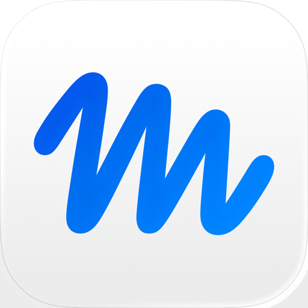

# Appendix: Agent Email

!!! info "Research notes — not yet a finished chapter"
    This appendix holds research gathered on **October 21, 2026**, as a
    follow-up to [Personal Agent Software](personal-agent-software/index.md).
    Most claims are vendor-stated or come from press and vendor blogs. Only the
    Grok Bot inbox was tested first-hand (by the author, in October 2026), and
    every other entry is untested. Features in this area changed within days of
    announcement, so verify against each vendor's own pages before relying on
    anything here.

## Why an agent's own address matters

An always-on agent that can only use *your* mailbox acts as you. That has two
costs for a research group:

- **No separation.** Mail the agent sends comes from your address, and mail it
  reads is your private mail, including anything unpublished.
- **Stalled sign-ups.** Several products filter one-time codes, password-reset
  links, and magic links out of the connected mailbox, so an agent cannot finish
  creating an account on a service for you.

An address of the agent's own fixes both problems. People can also email the
agent like a colleague, forward it a message, or add it to a thread. The cost is
a new way in for attackers: any message sent to that address is untrusted input
the agent will read.

!!! warning "Prompt injection through the inbox"
    A malicious email can carry hidden instructions aimed at the agent. Treat
    anything that arrives at an agent-owned address as untrusted data, keep
    approval rules on for sending and spending, and do not give the agent
    standing access to unpublished research data it does not need.

## Summary

Three terms recur below. A **built-in address** is one the vendor provisions.
A **bolt-on address** comes from a separate service you connect yourself. A
**text channel** is any way to message the agent from a phone, such as SMS,
iMessage, or WhatsApp.

| | Built-in own email | Text messaging | Bolt-on option | Evidence quality |
|---|---|---|---|---|
| **Grok Bot** | **Yes**, `@mail.grokbot.com`, since Oct 9, 2026 | None found | AgentMail plugin (email only) | Author-tested; vendor post on X |
| **Dots** | **No** at launch | SMS reported as limited beta or "coming"; sources conflict | AgentMail (vendor claim) | Help-center text via search summary; secondary press |
| **Muse** | **Announced, not shipped** | WhatsApp (confirmed); SMS none found | AgentMail via Secrets tab (vendor claim) | Meta launch post; TechCrunch |
| **Claude Cowork** | **No** | Phone app only (Dispatch); no SMS found | Third-party inboxes (vendor claims) | Anthropic help article; vendor blogs |
| **Gemini Spark** | **Yes**, its own Gmail address (press-reported) | Texting announced, not shipped | None needed for email | Press; no first-party page read |

## Grok Bot (SpaceXAI)

{ align=right width="90" }

Grok Bot is the one product here that has shipped a built-in inbox for its
bots, and it is the only one the author has tested.

### Email

- **Announcement.** The official `@bot` account on X announced on October 9,
  2026 that a bot can now have its own inbox. Elon Musk replied "Yes" when asked
  if it was real; that one-word reply is the only executive confirmation we
  found. SpaceXAI posted it on X and we found no help page or release notes.
- **Address.** Every address ends in `@mail.grokbot.com`, and the user chooses
  the name in front of the `@`. You claim it by asking the bot in chat or by
  tagging `@bot` on X. The bot checks that the name is free and asks for your
  approval first.
- **Permanent names.** One write-up says addresses are unique and are never
  reissued, even after you delete them, so choose carefully.
- **What it is for.** The stated uses are signing up for services (receiving the
  confirmation link or one-time code and finishing the sign-up), contacting
  businesses to book or request quotes, and arranging meeting times by email.
- **Team plans.** An admin must switch the feature on before members can use it.
- **Author test.** The author sent a test message to a bot's address and the
  bot replied from that same address.

### Text messaging

We found no reporting of SMS, iMessage, or a phone number for Grok Bot. Work is
assigned in a chat window on desktop or iOS. Because each bot has a cloud
computer that signs in to websites, it could in principle register for a
third-party phone-number service, but we did not test that and found no
documentation of it.

### Bolt-on options

- An **AgentMail** plugin has been available to Grok Bot users since August 2026,
  before the built-in address. Install it from Settings → Plugins, or add AgentMail
  as a custom MCP connector with an API key. The AgentMail page covers email only
  and says Grok Bot access for it is limited to the higher plans.
- Out of the box, Grok Bot can read a mailbox you connect through Gmail or
  Outlook, but that mailbox is yours, not the bot's.

### Open questions

- Pricing, sending limits, and country restrictions for the inbox are unpublished.
- It is not documented whether each outgoing email or sign-up needs approval.
- SpaceXAI's terms make the user responsible for "agentic actions," and those
  include sending communications. A bot that emails the wrong business is the
  user's problem.
- Practical limits of about 50 bots per account and six per group chat were
  reported with the announcement.

## Dots (OpenAI)

{ align=right width="90" }

### Email

**No, not at launch.** OpenAI's help article "Getting started with your dot" is
quoted by a search tool as saying a dot cannot have its own standalone email
address at launch. A dot can instead use your personal email account, which you
connect for your tasks. Custom rules can restrict that use, for example telling
a dot never to send email.

A follow-up report dated October 1, 2026 said OpenAI had not changed dots'
pricing, regions, or email addresses since the September 29 launch. We found
nothing newer.

!!! warning "Source limit"
    OpenAI's help pages returned HTTP 403 to our fetches, so we did not read
    them ourselves. The quoted wording above reaches us through a search
    summary. Open the [OpenAI help article](https://help.openai.com/en/articles/20001530-getting-started-with-your-dot)
    yourself before relying on it.

### Text messaging

Sources conflict, so treat all of this as unconfirmed:

- OpenAI said dots will "soon" be available on other messaging apps and over the
  phone, without naming apps or dates.
- Agent Sonic, a competing product vendor, lists SMS as a **limited beta for
  U.S. Pro users**, with carrier charges possible, and says WhatsApp is not a
  launch channel. It cites no OpenAI page.
- Tom's Guide and MarkTechPost describe texting as planned.
- OpenAI's Enterprise help page is reported to say phone messaging through
  iMessage, RCS, or WhatsApp is unavailable for Enterprise at launch.
- A dot cannot place phone calls to the user at launch, and setup is
  desktop-only.
- Slack and Microsoft Teams integrations were announced.

### Bolt-on options

AgentMail publishes a guide for giving a dot its own address: connect AgentMail
in the conversation and the dot creates an inbox it can send from and receive
at. That is vendor marketing for a product the vendor sells, and we did not
test it.

## Muse (Meta)

{ align=right width="90" }

### Email

**Announced, not shipped.** At Meta Connect on September 23, 2026, Alexandr
Wang said each Muse agent will get its own email address "soon," giving no date.
TechCrunch reports it is still in development and quotes the reasoning that an
agent running in the background will naturally need one. Users will be able to
forward messages to the agent or add it to a thread.

- **Domain unknown.** TechCrunch does not say what the address will look like.
  One outlet describes it as an `@muse.ai` inbox, which we could not confirm.
- **Why it matters here.** Muse's Gmail connector filters out one-time tokens,
  password-reset links, and login magic links, so account sign-ups can stall.
  That is the gap a separate inbox would fill.
- **Today.** Meta's own launch post describes only connecting your existing
  email, and lets you choose whether Muse reads your mail or can also send on
  your behalf.

### Text messaging

Meta's launch post says talking to Muse "works just like messaging another
person," in the Muse app or directly in **WhatsApp**. You link WhatsApp under
Settings → Messaging channels. Muse is separate from the free Meta AI assistant
already inside WhatsApp. We found no SMS channel and no dedicated phone number
for Muse; results about WhatsApp numbers concerned Meta's business agents, a
different product.

### Bolt-on options

AgentMail publishes a setup guide that works today: create an API key, paste it
into the Secrets tab Muse opens (not into the chat), and approve the connection.
Muse then creates its own inbox, by default on `agentmail.to`, or on a custom
domain with a paid AgentMail plan. This is vendor material and we did not test
it. The Secrets-tab design is a useful detail: the key never passes through the
model's chat context.

## Claude Cowork (Anthropic)

{ align=right width="90" }

### Email

**No.** Anthropic's [Cowork help article](https://support.claude.com/en/articles/16761823-claude-cowork-and-chat-are-one-claude)
mentions no agent address, no inbox others can email, and no agent email
feature. Cowork reaches mail only through the same connectors as Claude chat,
such as Gmail and Microsoft 365, and those act on **your** account.

- **Sending is supervised.** Anthropic's help center says the Gmail connector
  can send, reply to, and forward, and asks for approval before each action by
  default. Team and Enterprise owners decide whether members can let those
  actions run without asking.
- **Conflicting claims.** One Claude docs page describes the Gmail connector as
  read-only, and a third-party blog says Cowork sends only through Microsoft
  365. These conflict with the help center, which was updated most recently.
- **No inbound work.** One comparison says nobody outside your Claude account
  can send Cowork work, and every task, including scheduled ones, starts with
  you.
- **A hint, not a feature.** A RuntimeWire report from October 19, 2026 says
  Claude's web code contains a new organization-level setting for CC'ing Claude
  on email. The report found no address, workflow, or rollout date, and
  Anthropic has confirmed nothing.

### Text messaging

Cowork's phone channel is **Dispatch**, which gives you one persistent thread
between the Claude mobile app and Claude Desktop. Your computer does the work
and must stay awake and online. Dispatch launched as a research preview on
March 17, 2026, and Anthropic's current article lists it as unavailable to new
users. We found no SMS, iMessage, or Telegram support.

### Bolt-on options

AgentMail, Email Bump, and Carly each sell dedicated agent inboxes that connect
to Cowork through connectors or MCP. We saw them only in search results, which
call out Email Bump addresses on `misomail.co`. All three are commercial claims
that we did not verify. Cowork supports MCP connectors, which is the extension
point that makes these workable.

## Gemini Spark (Google)

{ align=right width="90" }

### Email

**Yes, press-reported.** The Next Web says users "can email Spark directly
through a dedicated Gmail address, much as they would message a human
colleague." Other sources describe Spark as a teammate with its own Gmail
address. None gave the address itself or the setup steps, and we read no Google
page on it. It is the only mainstream product here where the address is part of
the original launch, announced May 19, 2026 at Google I/O.

Google's Workspace tie-in helps here: Spark already reaches Gmail, Docs, and
Calendar without manual setup. Press says it asks before high-stakes actions
such as sending email, and that Google connectors are off until you enable them.

### Text messaging

**Announced, not shipped.** Google's I/O materials list texting Spark, along
with emailing it, creating custom sub-agents, and operating your local browser,
among abilities coming later. We found no report that texting was live. The
Next Web article does not mention texting at all.

### Bolt-on options

None are needed for email. We did not look for a bolt-on text service for Spark.

## Adding email or texting yourself

A growing set of services give any agent a mailbox or a phone number, provided
the agent can call tools. Which products allow this differs:

| Need | Service | Notes |
|---|---|---|
| Email inbox | **AgentMail** | Gives an agent a real inbox with threading and webhooks. Guides exist for Grok Bot, Dots, Muse, and Claude. Vendor-published. |
| Email inbox | Email Bump, Carly | Named in search results for Cowork. Not examined. |
| SMS and voice | **AgentPhone** | Y Combinator-backed. Provisions a U.S. or Canadian number per agent through one API call. Vendor claims. |
| SMS and voice | Dial | Claims a number in about ten seconds and says it can read inbound codes for phone-gated sign-ups. Names Grok Bot and Claude Code as clients. Vendor claims. |
| SMS and voice | Twilio | The do-it-yourself route. Hermes Agent ships a telephony skill that can buy a Twilio number and send and receive SMS. |

None of the text services above were tested, and our search found no
Muse- or Dots-specific SMS guide. Two cautions apply to all of them:

- **Cost and abuse.** An agent with a purchasable number can spend money and
  message strangers. Keep spending limits and require approval to send.
- **Verification codes.** A number that receives sign-up codes lets the agent
  create accounts on its own. Decide whether that is something you want an
  unattended agent to do.

## Caveats and gaps

- **No first-party reading for Dots or Spark.** OpenAI's help pages returned
  HTTP 403, and no Google page on Spark's address was read.
- **Vendor-heavy sources.** Most "how to add email" guides are published by the
  companies that sell the inbox, and they rank their own product.
- **One tested claim.** Only the Grok Bot inbox was verified first-hand. The
  author has not tried any bolt-on service.
- **Fast-moving.** The Grok Bot announcement was twelve days old and the Claude
  CC report two days old when this was written.
- **Text channels differ in kind.** WhatsApp, Dispatch, Slack, and SMS differ in
  who can message the agent and who pays. We did not compare them in detail.

## Questions to resolve before this becomes a chapter

1. Does each agent require approval before sending an email or signing up for a
   service, and can that be set per recipient?
2. How does each vendor treat mail the agent receives: logged, retained, used
   for training, or visible to admins?
3. Which agent could safely hold a lab-group address that collaborators email
   with data requests?
4. What should a research group's rule be for an agent that can sign up for
   outside services on its own?

## Sources

Product names and logos belong to their owners; see the
[Personal Agent Software appendix](personal-agent-software/index.md) for where
each icon came from. Items marked "not read directly" reached us only through a
search summary.

- [Grok Bot on X — email announcement, Oct 9, 2026](https://x.com/bot/status/2108609764766908772) (cited by a secondary write-up; not read directly)
- [Mad Robot — Grok Bot now has its own email address](https://madrobot.blog/2026/10/09/grok-bot-own-email-address-mail-grokbot/)
- [AgentMail — Grok Bot integration](https://docs.agentmail.to/integrations/grokbot)
- [OpenAI help — Getting started with your dot](https://help.openai.com/en/articles/20001530-getting-started-with-your-dot) (HTTP 403; not read directly)
- [OpenAI help — Manage dots in ChatGPT workspaces](https://help.openai.com/en/articles/20001554-manage-dots-in-chatgpt-workspaces) (not read directly)
- [Agent Sonic — Can OpenAI Dots work on WhatsApp?](https://www.tryagentsonic.com/articles/openai-dots-whatsapp) (competing vendor)
- [AgentMail — How to give your dot its own email address](https://www.agentmail.to/blog/give-dot-email-address) (vendor; not read directly)
- [TechCrunch — Everything new coming to Meta's AI agent Muse](https://techcrunch.com/2026/09/23/everything-new-coming-to-metas-ai-agent-muse/)
- [Meta — Introducing Muse](https://about.fb.com/news/2026/09/introducing-muse-personal-ai-agent/)
- [AgentMail — How to give Meta Muse its own email address](https://www.agentmail.to/blog/give-muse-email-address) (vendor)
- [Anthropic — Claude Cowork and chat are one Claude](https://support.claude.com/en/articles/16761823-claude-cowork-and-chat-are-one-claude)
- [Anthropic — Use Google Workspace connectors](https://support.claude.com/en/articles/10166901-use-google-workspace-connectors) (not read directly)
- [RuntimeWire — Anthropic's code hints at a gated way to CC Claude on email](https://runtimewire.com/article/exclusive-anthropic-s-code-hints-at-a-gated-way-to-cc-claude-on-email) (not read directly)
- [DataCamp — Claude Cowork Dispatch 101](https://www.datacamp.com/tutorial/claude-cowork-dispatch) (not read directly)
- [The Next Web — Google launches Gemini Spark](https://thenextweb.com/news/google-gemini-spark-agentic-assistant-gmail-io-2026)
- [Google — The Gemini app becomes more agentic](https://blog.google/intl/fr-fr/nouveautes-produits/io-evolution-gemini-app/) (French edition; not read directly)
- [AgentPhone on Y Combinator](https://ycombinator.com/companies/agentphone) (vendor; not read directly)
- [Hermes Agent — telephony skill](https://hermes-agent.nousresearch.com/docs/user-guide/skills/optional/productivity/productivity-telephony) (not read directly)
