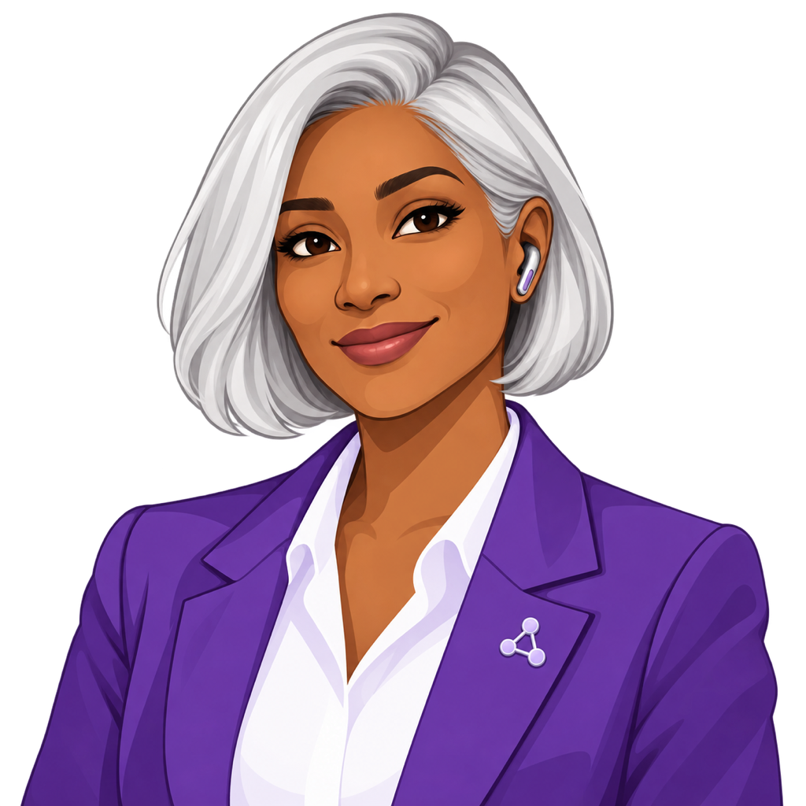
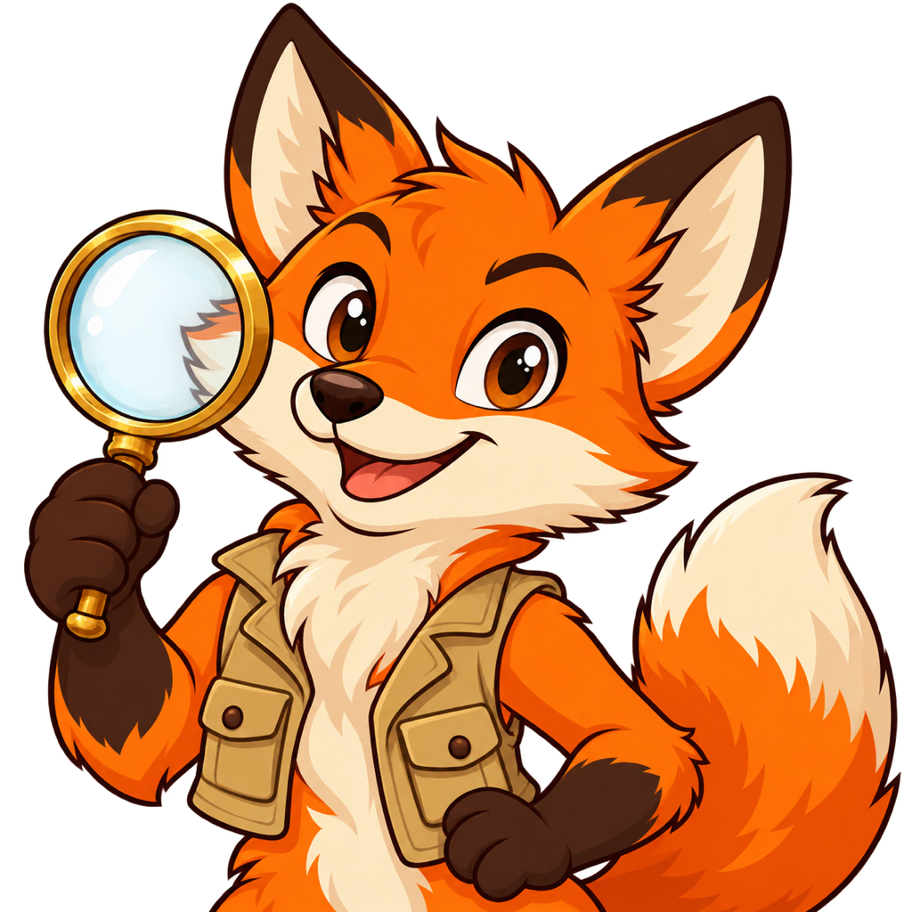
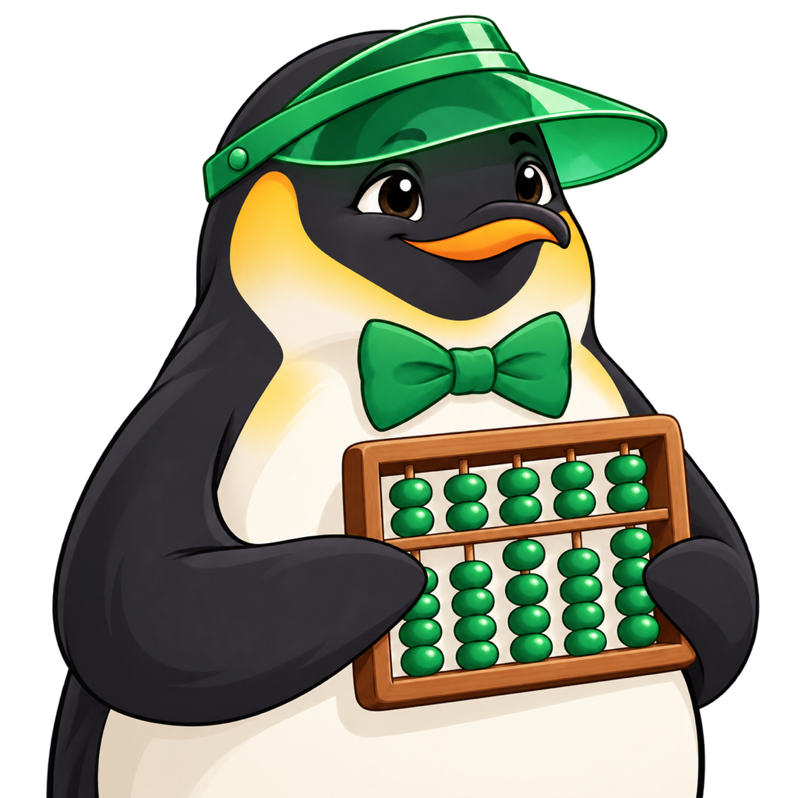
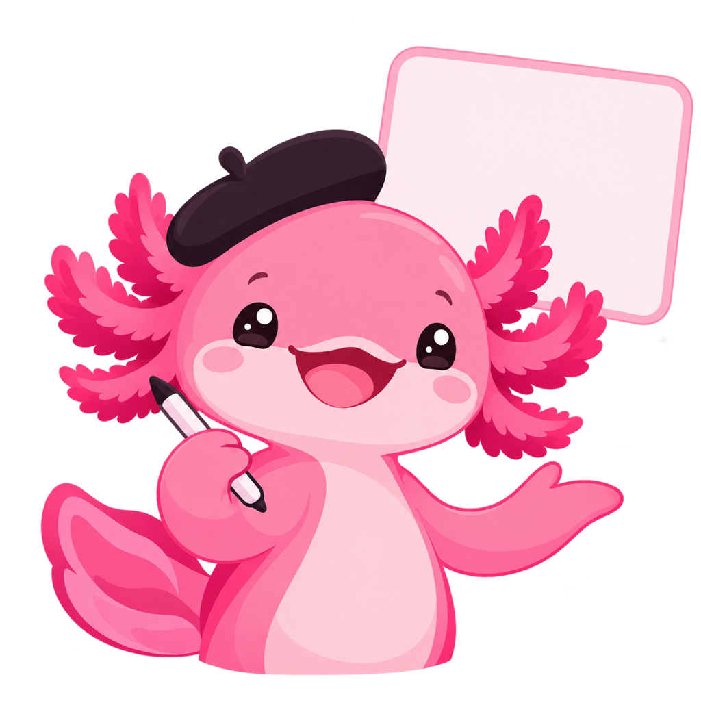
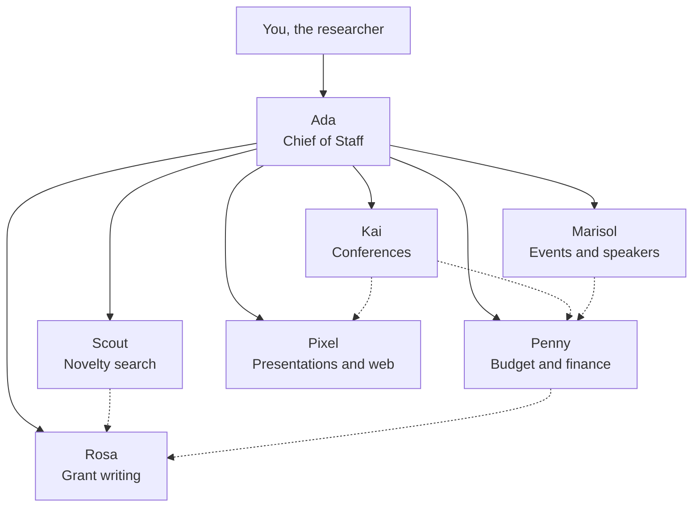

# Appendix: Agent Personas

A research group can give each of its agents a face, a color, and a clear job.
That makes a dashboard of agent activity easy to scan: you see at a glance who
is working, who is waiting on you, and who is stuck. The seven personas below
are a sample team for an EE researcher. [Ada](ada-chief-of-staff.md) is the
chief of staff; the other six are specialists who report to Ada, and Ada
reports to you.

<iframe src="../../posters/your-agent-team/main.html" height="760px" width="100%" scrolling="no"></iframe>

[Display Poster Fullscreen](../../posters/your-agent-team/main.html){ .md-button .md-button--primary target="_blank" }

| Icon | Persona | Role |
|---|---|---|
| { width="72" } | [Ada](ada-chief-of-staff.md) (violet) | **Chief of Staff.** Your personal assistant: maintains your personal knowledge graph, reads and triages your email, manages your calendar, and coordinates the work of every other agent. |
| { width="72" } | [Scout](scout-novelty-search.md) (orange) | **Novelty and prior-art search.** Searches papers, patents, and code to tell you whether a new idea is really new, and watches your topics for relevant new work. |
| { width="72" } | [Marisol](marisol-events-speakers.md) (teal) | **Department events and speakers.** Runs the seminar and event calendar, and finds, invites, and confirms speakers along with rooms, travel, and hosting. |
| { width="72" } | [Penny](penny-budget-finance.md) (green) | **Lab budgets and finance.** Tracks grant spending and burn rates, forecasts overruns, and drafts purchase requests and expense reports for your approval. |
| { width="72" } | [Rosa](rosa-grant-writing.md) (red) | **Grant writing.** Finds funding opportunities that fit your research, then drafts, critiques, and tracks proposals through to the submission deadline. |
| { width="72" } | [Pixel](pixel-presentations-web.md) (pink) | **Presentations and web presence.** Builds slide decks, posters, and figures, and keeps your university web page current. |
| { width="72" } | [Kai](kai-conferences.md) (yellow) | **Conferences and speaking proposals.** Tracks calls for papers and deadlines, vets venues, drafts abstracts and talk proposals, and plans travel. |

### How the team fits together

Solid arrows are the reporting line. Dotted arrows are the common hand-offs
between specialists, such as Scout's prior-art summary feeding Rosa's proposal.
Each sheet lists its own hand-offs and approval rules.

### Using the personas on a dashboard

- **Ring color.** Each avatar gets a ring in its signature color, so a card is
  recognizable even when the face is small.
- **Status badge.** Use five states: *Idle*, *Working*, *Waiting on you*,
  *Blocked*, and *Done*. Give each badge its own shape or icon as well as a
  color, so the status does not depend on color alone.
- **Task list.** Each card shows the agent's current tasks. The sample tasks in
  every sheet are illustrative, not real data.
- **Approval rules.** Every sheet lists what the agent does alone, what it asks
  first, and what it never does. These follow the book's rule of "trust, but
  verify": agents draft and prepare, and a human sends, submits, signs, and pays.

### Shared art style

Every image prompt uses the same style line as the Volt mascot: flat vector
cartoon, clean lines, solid colors, soft rounded shapes, transparent
background, no text in the image, readable at about 90 px. Paste the prompts
into the same image-generator conversation so the seven avatars come out as a
consistent set.
