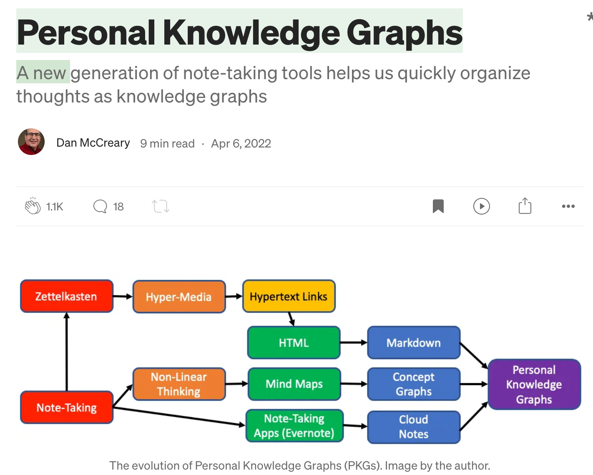

# Appendix: Personal Knowledge Graphs

!!! info "Summary of prior research"
    This appendix summarizes the author's earlier work on personal knowledge
    graphs. It is based on the book-chapter version of that work
    (*Integrating personal knowledge graphs into the enterprise*, Chapter 14),
    which `docs/pkg.md` in the author's profile site states is the same content
    as the original blogs, reformatted for the book. The blog pages themselves
    could not be fetched while preparing this summary (HTTP 403), so the blogs
    were not compared line by line against the chapter.

## Primary reference

Ketter, W., Batchu, A., Berosik, G., and McCreary, D. (2008). [A semantic web
architecture for advocate agents to determine preferences and facilitate
decision making](https://dl.acm.org/doi/10.1145/1409540.1409554). *Proceedings
of the 10th International Conference on Electronic Commerce (ICEC '08)*, ACM,
pp. 1-10. The full citation is the first entry in the book's
[References](../../references.md).

## The thesis

High-quality personal AI agents need access to a person's notes, and the best
place to keep notes is a **personal knowledge graph (PKG)**: concepts stored as
nodes, with the relationships between them stored as links. The hard part is not
the single-user case. It is integrating many individual PKGs into an
organization's collective knowledge, which the author calls an **integrated
personal knowledge graph (IPKG)**, without losing the speed of personal note
taking or exposing knowledge to the wrong people. The research focuses on how to
do that securely.

## What we mean by knowledge

Before a graph can hold knowledge, we need a working definition of it. The
**Knowledge Triangle** shows three layers of increasing value. Raw **data** is
the largest volume but has the lowest meaning. **Information** is isolated facts
extracted from that data. **Knowledge** is facts connected by meaningful
relationships, which is exactly what a graph stores. Hover over each layer for a
description.

<iframe src="https://dmccreary.github.io/intro-to-graph/sims/knowledge-triangle/main.html"
        height="502px"
        width="100%"
        scrolling="no"></iframe>

[Run the Knowledge Triangle MicroSim fullscreen](https://dmccreary.github.io/intro-to-graph/sims/knowledge-triangle/main.html){ .md-button .md-button--primary }

The sim is hosted in the author's *Introduction to Graph Databases* book, where
it has its own [lesson page](https://dmccreary.github.io/intro-to-graph/sims/knowledge-triangle/).

## Publications

| Work | Venue and date | Focus |
|---|---|---|
| [Personal Knowledge Graphs](https://medium.com/data-science/personal-knowledge-graphs-9a23a0b099af) | Towards Data Science, April 6, 2022 | What PKGs are and why they matter; one of the most popular of the series |
| [Integrating PKGs into the Enterprise](https://dmccreary.medium.com/integrating-pkgs-into-the-enterprise-31c913b96b94) | Medium, December 5, 2022 | Integration challenges and steps |
| [Integrating Siloed Personal Knowledge Graphs](https://dmccreary.medium.com/integrating-siloed-personal-knowledge-graphs-d0e68bd06685) | Medium, December 10, 2022 | Bringing isolated PKGs together |
| [Controlling Access to IPKGs](https://dmccreary.medium.com/controlling-access-to-ipkgs-8fbc5e0d6896) | Medium, December 11, 2022 | Role-based access control for shared graphs |
| *Personal Knowledge Graphs: Methodology, Tools and Applications*, Chapter 14, [abstract](https://digital-library.theiet.org/doi/abs/10.1049/PBPC063E_ch14) and [PDF](https://github.com/dmccreary/dmccreary/blob/master/PKG-Chapter-14.pdf) | IET book, [Amazon listing](https://www.amazon.com/Personal-Knowledge-Graphs-PKGs-applications/dp/1839537019) | The blogs consolidated and reformatted; see [References](../../references.md) |

*The April 6, 2022 article as published on Medium, with 1.1K claps. The diagram
shows the evolution of personal knowledge graphs from Zettelkasten and
note-taking, through hypertext, HTML and Markdown, mind maps, concept graphs
and cloud note-taking apps. Image by the author.*

## Key ideas from the research

### Where PKGs came from

The chapter traces PKGs through a lineage of ideas for linking notes:

1. Zettelkasten, the 1500s linked index-card system built on one concept per
   card and explicit links between concepts.
2. Hypermedia and hypertext in the 1960s, then HTML and the World Wide Web.
3. The Semantic Web in 2001, which added relationship types to links.
4. Electronic note-taking tools such as outliners, mind maps, and Evernote.
5. Markdown in 2004, a lightweight format that any text editor can produce.
6. Tools such as Roam Research and Obsidian, which combine hyperlinks,
   Markdown, and graphs.

The author's point is that Markdown matters: it is why notes can survive
changes of tool, which is the same reason this book uses Markdown for project
knowledge.

### Why people use PKGs

The chapter lists five advantages that practitioners report:

- **Quickly organize thoughts.** Typing `[[` turns a phrase into a node, and
  autocomplete shows whether the concept already exists.
- **Lower cognitive load.** Notes are linked to existing knowledge as they are
  taken, so the PKG acts as a "second brain" that offloads memory.
- **Non-linear thinking.** Concepts connect in any order instead of in the
  fixed order of sections in a document.
- **Long-term persistence.** Plain Markdown outlasts the tools used to edit it.
- **Breaking writer's block.** Small subgraphs grow over time, like a "digital
  garden of ideas."

### Limits of the tools

The chapter also names real problems at the time of writing: sharing a
subgraph with others is crude import and export, graph visualization is
limited, relationships are untyped, and tools have no fine-grained role-based
access control. It raises an ownership question too. A "personal" graph of work
knowledge overlaps with an employer's intellectual property.

### The free-form versus structured tension

The central design tension is between fast, free-form personal note taking and
the consistent structure an organization needs to reuse knowledge.

| Free form | Structured |
|---|---|
| No rules, quick and easy | Many rules, slow but consistent |
| Low semantics | High semantics |
| Hard to validate and query | Easy to validate and query |
| Example: Notepad | Example: Wikipedia Infobox |

The chapter places tools on a spectrum from Notepad and wikis, through PKGs, to
ontology editors such as Protege and graph databases such as Neo4j and
TigerGraph, with a not-yet-built "ML-PKG" that uses machine learning to suggest
links as you type.

Two ideas follow from this tension:

- **Typed versus untyped links.** A wiki links pages of a single type with a
  single relationship ("is related to"). A true knowledge graph gives each node
  and edge a type, which is what makes it queryable. The author cites Jim
  Hendler's hypothesis that "a little semantics goes a long way."
- **Name uniqueness and aliases.** PKGs should refuse duplicate concept names,
  offer to merge on rename, and support aliases, which many tools do poorly.

### Making integration feel fast

The practical recipe is to extend the **as-you-type loop** with organizational
knowledge instead of adding forms:

- Trigger characters such as `[[`, `@` (people), and `#` (tags), plus prefixes
  such as `g:` for a company glossary, pull suggestions from enterprise lists.
- Monitor the **acceptance rate** of suggestions and aim for 30% or higher
  before wide rollout, or users will turn the feature off.
- Link to **permalinks** (PURLs) rather than file paths, and monitor for broken
  links, because broken links erode trust.
- Use bidirectional links so renaming a concept updates every reference.
  The author's rule of thumb is that about 60% of a knowledge graph's value is
  in its nodes and 40% in its relationships.
- Run NLP in real time (entity extraction, classification), within roughly
  100 ms, so suggestions do not interrupt typing.
- Expect to write converters, because each tool extends Markdown differently.

### Steps to integrate PKGs into the enterprise

The chapter proposes the **IPKG hypothesis**: users of integrated PKGs will
create more valuable knowledge than users of siloed note-taking tools. It then
gives a roll-out plan:

1. Align benefits with the organization's strategy (sharing knowledge,
   avoiding duplication, consistency, collaboration, productivity, search).
2. Find an executive sponsor.
3. Define metrics that a non-specialist can understand, starting with simple
   features such as shared spell-check dictionaries and automatic hyperlinking
   of glossary terms.
4. Inventory existing knowledge repositories (glossaries, product catalogs,
   employee names, wiki pages, system lists).
5. Draw a reference architecture diagram with sources on the left, the IPKG in
   the middle, and consumers on the right.

### Controlling access

Access control is easy for one person and hard for an organization. The chapter
defines the vocabulary (vertex, subgraph, the public graph, roles, access types
such as read, rename, move, update and delete, authentication, authorization)
and recommends a role-based model:

- Grant permissions to **roles and named groups**, not to individuals, so
  access does not need to change every time someone moves teams.
- Let people create **shared subgraphs** with their own permissions.
- Treat the **ontology management problem** carefully: low-level changes
  such as fixing a typo are cheap, but changes to upper ontologies ripple into
  downstream consumers and need version control and regression tests.
- Expect **merge conflicts**. Copying a page from a private graph into a shared
  one breaks the links that depended on private concepts, so it is often better
  to create the concept in the shared context in the first place.

## How this connects to the book

The research supplies the concepts behind the personal knowledge graph material
in [Chapter 6](../../chapters/06-knowledge-bases-skill-anatomy/index.md) and
[Chapter 19](../../chapters/19-always-on-personal-agents/index.md):

| Learning graph concept | Where the research speaks to it |
|---|---|
| Knowledge Graph, Entity and Relationship | Nodes (vertices) and typed edges; graphs versus flat lists of concepts |
| Personal Knowledge Graph | The core subject of the blogs and chapter |
| Graph Schema | Typed vertices and edges; "a little semantics goes a long way" |
| Backlinks | Bidirectional links that update when a concept is renamed |
| Entity Extraction | Real-time NLP for entities and facts while typing |
| Personal Knowledge Privacy | Ownership of a "personal" graph; role-based access control |
| Graph Retrieval Augmented Generation, Knowledge Graph Memory | Not covered directly; the chapter anticipates ML-assisted PKGs, and the opening thesis ties PKGs to personal agents |

## Gaps to fill

- **Written before LLM agents.** The chapter expects BERT and GPT-3 to make
  ML-assisted PKGs practical. Retrieval over graphs and agent memory are the
  natural updates, and this book's [Personal Agents](../personal-agents/index.md)
  appendix covers the agent side.
- **Blogs not re-read.** The four blog posts were not fetched, so details that
  exist only in the blogs are missing from this summary.
- **Reach and influence.** Two points are documented: the work was republished
  as Chapter 14 of an IET book (the DOI and Amazon links are in the
  Publications table), and the Towards Data Science article shows 1.1K claps in
  a screenshot of the Medium page. One point is the author's own claim and is
  not independently checked: that many other projects use the blogs as a basis
  for personal knowledge agents. Naming a few of those projects would turn it
  into a citation.
