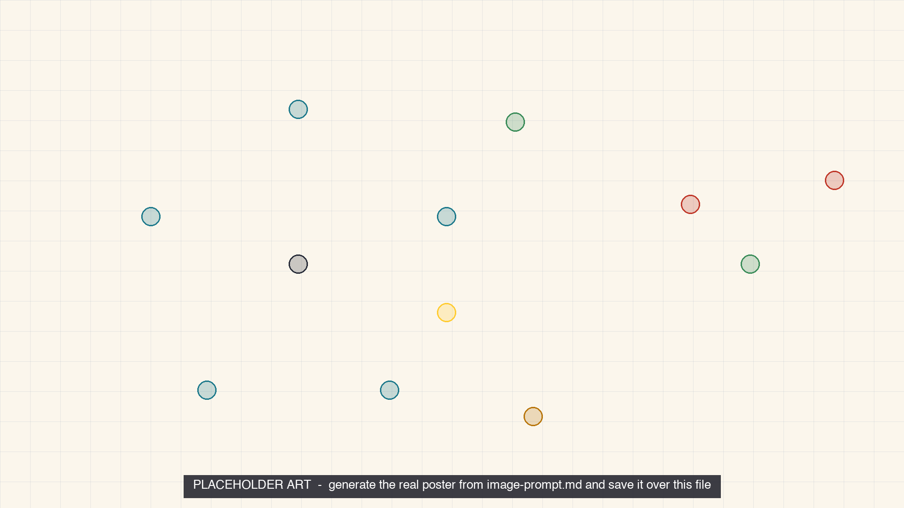

<iframe src="./main.html" height="1000px" width="100%" scrolling="no"></iframe>

[Open the interactive poster full screen](./main.html){ .md-button .md-button--primary }

Use **Explore** mode to hover over a numbered marker or its label and read what that part of the loop or the sandbox does. Use **Quiz** mode to read a clue and click the marker that matches. The marker numbers are hidden in Quiz mode, so you must find the matching part of the picture. The loop is on the left. The permission rings are on the right.

The twelve callouts are:

1. **Repeat or Stop** — The loop goes around again, or ends when the task is done, an error occurs, or a limit is reached.
2. **Decide** — The model reads the task, the context, and the tool definitions, and picks an action.
3. **Call** — The model writes a structured tool call. Nothing has run yet.
4. **Subagent Side Loop** — A separate agent with its own context takes one part of the job and returns a summary.
5. **Rest of Your Machine** — Credentials, other projects, and everything outside the project directory.
6. **Network and Other Accounts** — Remotes, outbound data, installs, and downloaded code.
7. **Observe** — The result goes into the context, and the model reads it.
8. **Tool Bench** — Files, a shell, code execution, the web, and MCP connectors.
9. **Run** — The harness executes the call after checking the permission rules.
10. **Hook Gate** — A script that always runs at a set moment and can pause or veto a call.
11. **Step and Cost Meter** — Step, time, and spending limits against a runaway loop.
12. **Inside the Project** — The directory where the agent may work, with raw data protected.

## Static Poster

{ loading=lazy }

The full-size poster above is a static copy of the interactive version, handy for printing, sharing, or viewing without JavaScript. Until the final artwork is generated, the image is placeholder art.

## Why This Matters

Chapter 8 explains that a language model only emits text. Tool use turns that text into actions: the model writes a tool call, a program called the harness runs it, and the result returns to the model. That cycle is the agent loop. Sandboxing limits what a running process can reach, permissions decide which calls are allowed, need approval, or are denied, and hooks enforce rules that must never be skipped.

The permission rules on the poster follow the chapter's illustrative policy. They are an example, not a recommended configuration, and each tool uses its own syntax. The poster does not say that a sandbox or a permission list makes an agent safe. Each catches different mistakes, and version control, logs, and step limits still matter. Trust, but verify!

## Connects to

- [Chapter 8: Agents, Tool Use, and Subagents](../../chapters/08-agents-tool-use-subagents/index.md)
- [Chapter 9: Supervising Agents and Defining Agent Roles](../../chapters/09-supervising-agents-roles/index.md)

## Source

Chapter 8, sections "Tool Use and the Agent Loop", "Reaching Files, Shells, and Code", "Sandboxing and Permissions", "Reaching Outside: MCP, Data Sources, and Skills With Scripts", and "Subagents, Parallel Work, Memory, and Hooks". Chapter 9, section "Logging, Failure Modes, and Runaway Agents", for runaway agents and cost control.

Teachers and editors can open [calibration mode](./main.html?edit=true) to drag the markers and copy updated coordinates after the artwork is generated.
