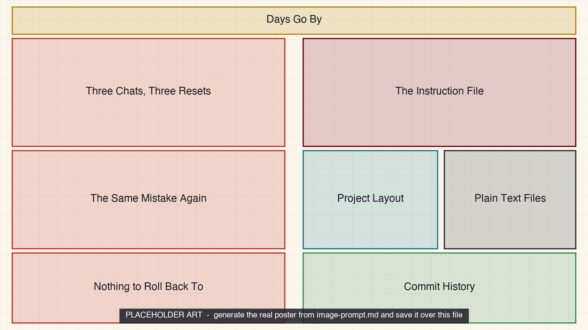

<!-- poster-art:begin -->
<iframe src="./main.html" height="1000px" width="100%" scrolling="no"></iframe>

[Open the interactive poster full screen](./main.html){ .md-button .md-button--primary }
<!-- poster-art:end -->

Use **Explore** mode to hover over or click a panel and read what it shows about working without memory and working with a project. Use **Quiz** mode to read a clue and click the panel it describes.

A calendar runs across the top of both halves to show time passing. The left half keeps nothing between sessions. The right half keeps the goals, the files, and the history.

The seven regions are:

1. **Days Go By** — Time passes across both halves while sessions end and models change.
2. **Three Chats, Three Resets** — Each new conversation starts from nothing, and the same wrong assumption returns every time.
3. **Nothing to Roll Back To** — A timeline with no snapshots to compare or restore.
4. **The Instruction File** — The first document an agent reads: goals, conventions, constraints.
5. **Project Layout** — A predictable folder structure with read-only raw data.
6. **Plain Text Files** — Markdown, notebooks, and scripts that people and agents both read.
7. **Commit History** — Small saved snapshots, a rollback point, and a reviewed merge.

<!-- poster-static:begin -->
## Static Poster

{ loading=lazy }

The full-size poster above is a static copy of the interactive version, handy for printing, sharing, or viewing without JavaScript.
<!-- poster-static:end -->

## Why This Matters

Chapter 2 explains that a model has no memory of earlier conversations beyond what is in the prompt it is sent. A chat that seems to remember is resending its earlier turns. Chapter 5 builds the remedy from ordinary tools: a short instruction file the agent reads at the start of every session, plain-text files it can read directly, a predictable layout, and Git so that any change an agent makes can be reviewed and undone. The idea is not new. It is context engineering done once and reused every time.

The poster does not say chat is bad. Chapter 2 treats a chat interface as the right way to start and to explore, and the move to a project is for work that recurs or touches files. A file helps only if you keep it short, checkable, and free of secrets, and it does not replace reading the diff before accepting an agent's changes. The three tabs on the document are goals, conventions, and constraints, the three kinds of content Chapter 5 lists.

## Connects to

- [Chapter 5: Markdown Project Files and Version Control](../../chapters/05-markdown-and-version-control/index.md)
- [Chapter 2: How Language Models Work](../../chapters/02-how-language-models-work/index.md)
- [Chapter 4: Context Engineering and Advanced Prompting](../../chapters/04-context-engineering-prompting/index.md)

## Source

The linked chapters of this book, which supply the statelessness of the model, the history and window remedies, the instruction-file contents, the project layout, and the Git workflow. The ENOB values in the commit example are the chapter's own illustrative numbers.

Teachers and editors can open [calibration mode](./main.html?edit=true) to adjust zone positions after the artwork is generated. Copy only the `x1`, `y1`, `x2`, and `y2` numbers back into `data.json`, because the calibration export omits `showLabels` and `palette`.
