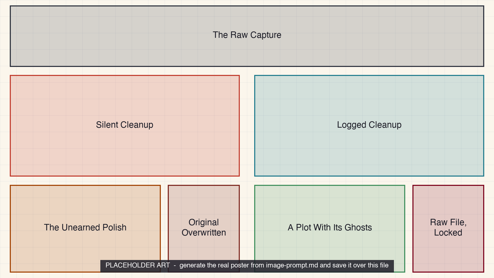

<iframe src="./main.html" height="1000px" width="100%" scrolling="no"></iframe>

[Open the interactive poster full screen](./main.html){ .md-button .md-button--primary }

Use **Explore** mode to hover over or click a panel and read what it shows. One raw capture at the top feeds two paths. The left half is a silent cleanup. The right half is a logged cleanup. Use **Quiz** mode to read a clue and click the panel it describes.

The seven regions are:

1. **The Raw Capture** — The measured data, shared by both paths, that a prompt cannot regenerate.
2. **Silent Cleanup** — A black box that returns tidy data and records nothing.
3. **The Unearned Polish** — A handsome plot with no way to check what was removed.
4. **Original Overwritten** — A raw file edited in place, so no untouched original remains.
5. **Logged Cleanup** — Named, visible steps that log the rows, the count, and the reason.
6. **A Plot With Its Ghosts** — A similar plot that keeps the removed points visible.
7. **Raw File, Locked** — The untouched original, read-only, with its sidecar.

## Static Poster

{ loading=lazy }

The full-size poster above is a static copy of the interactive version, handy for printing, sharing, or viewing without JavaScript. Until the final artwork is generated, this image is placeholder art.

## Why This Matters

Cleaning is the quietest source of wrong results in research. Every choice changes the answer, and nothing marks that a choice was made. An agent asked for a clean result has an incentive to remove what hurts it. Three rules keep it honest. Cleaning is a script and not an edit. Every change is logged. A point is removed only for a documented cause, and an undocumented outlier is kept, reported, and investigated.

The two final plots in the poster look alike on purpose, because a clean plot tells you nothing about whether the cleaning was honest. The difference is in what you can audit. The ghost points and the count bubble are a teaching device of the poster. The chapter asks for a log and for results reported with and without a step that changes a headline number, and it does not prescribe any particular plot style. The measurements quoted are the chapter's illustrative ones.

## Connects to

- [Chapter 12: AI-Assisted Data Analysis and Scripting](../../chapters/12-data-analysis-scripting/index.md)

## Source

The linked chapter of this book, including its sections on measurement data, data formats, and cleaning, and the data cleaning decision simulator. The 12 mV and 6.8 mV devices are the chapter's illustrative example.

Teachers and editors can open [calibration mode](./main.html?edit=true) to adjust zone positions after the artwork is generated. Copy only the `x1`, `y1`, `x2`, and `y2` numbers back into `data.json`, because the calibration export omits `showLabels` and `palette`.
