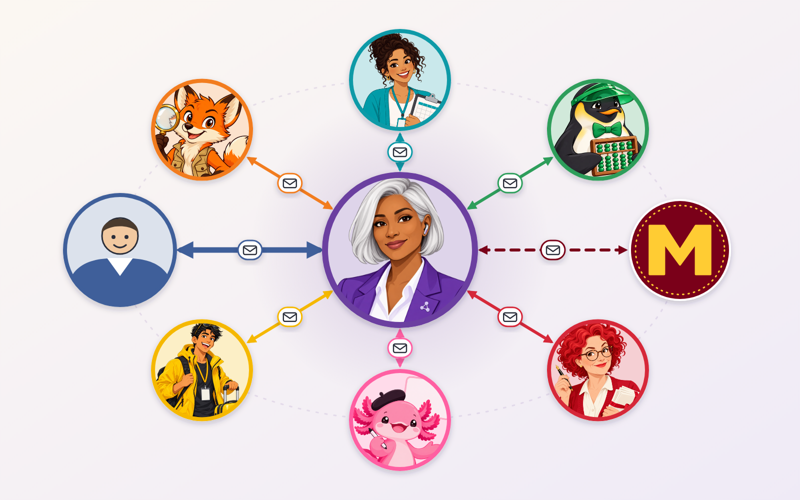

<!-- poster-art:begin -->
<iframe src="./main.html" height="800px" width="100%" scrolling="no"></iframe>

[Open the interactive poster full screen](./main.html){ .md-button .md-button--primary }
<!-- poster-art:end -->

The question is how to get all of your agents to communicate with each other, with the agents in your department, and with the agents at the University of Minnesota. One answer is a hub and spoke: **you** sit at the left, **Ada** the chief of staff sits in the middle, and every other agent has one spoke to Ada. Use **Explore** mode to hover over a numbered marker or its label and read what travels along that spoke. Use **Quiz** mode to read a clue and click the matching circle.

Seven agents that all message each other directly need 21 separate links. With a hub they need six, and you only watch one of them. The dashed spoke on the right crosses a boundary: it connects Ada to agents outside your own team.

The nine callouts are:

1. **Marisol: Events and Speakers** — Seminar calendar and speaker pipeline, reported through Ada.
2. **Scout: Novelty and Prior-Art Search** — The closest prior art, merged into your briefing.
3. **You** — One channel to watch, and the person who sends, submits, signs, and pays.
4. **Kai: Conferences and Proposals** — Deadlines and drafts that Ada checks against your calendar.
5. **Penny: Lab Budgets and Finance** — Balances and warnings, with paperwork ready for your signature.
6. **Ada: Chief of Staff (the Hub)** — Every agent reports to Ada, who decides what reaches you.
7. **University of Minnesota Agents** — The spoke to agents in your department and across the university.
8. **Rosa: Grant Writing** — Funding calls, outlines, and a skeptical review of your draft.
9. **Pixel: Presentations and Web** — Decks, figures, and your web page, built from the shared record.

The University of Minnesota badge in this picture is a generic maroon-and-gold placeholder, not the official logo.

<!-- poster-static:begin -->
## Static Poster

{ loading=lazy }

The full-size poster above is a static copy of the interactive version, handy for printing, sharing, or viewing without JavaScript.
<!-- poster-static:end -->
