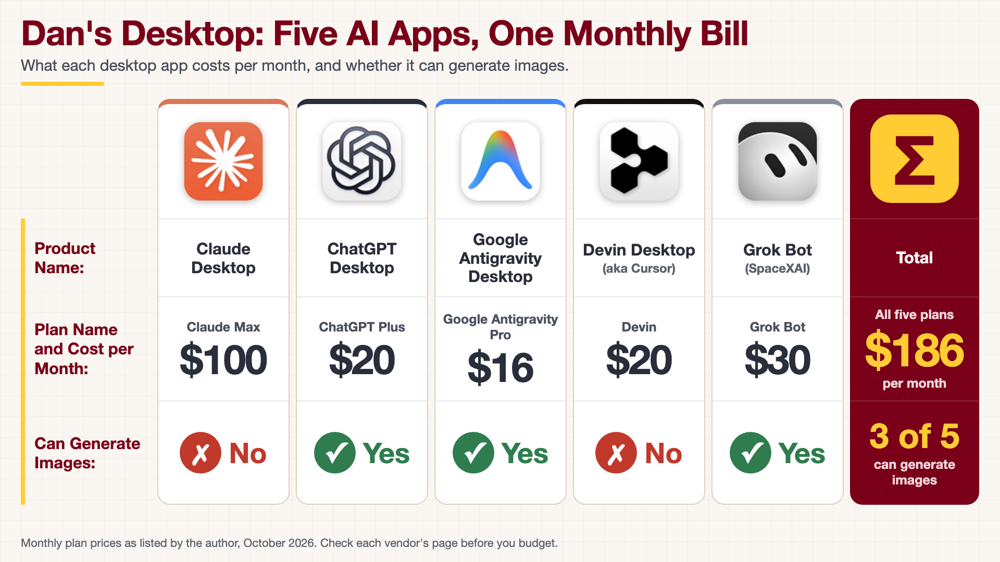

<!-- poster-art:begin -->
<iframe src="./main.html" height="1000px" width="100%" scrolling="no"></iframe>

[Open the interactive poster full screen](./main.html){ .md-button .md-button--primary }
<!-- poster-art:end -->

Use **Explore** mode to hover over or click a column and read the plan, its yearly cost, and its share of the bill. Use **Quiz** mode to read a clue and click the column it describes.

The six regions are:

1. **Claude Desktop** — Claude Max at $100 per month. It cannot generate images.
2. **ChatGPT Desktop** — ChatGPT Plus at $20 per month. It can generate images.
3. **Google Antigravity Desktop** — Google Antigravity Pro at $16 per month. It can generate images.
4. **Devin Desktop (aka Cursor)** — Devin at $20 per month. It cannot generate images.
5. **Grok Bot (SpaceXAI)** — Grok Bot at $30 per month. It can generate images.
6. **Total** — $186 per month for all five plans, and three of the five can generate images.

<!-- poster-static:begin -->
## Static Poster

{ loading=lazy }

The full-size poster above is a static copy of the interactive version, handy for printing, sharing, or viewing without JavaScript.
<!-- poster-static:end -->

## Why This Matters

A research workflow rarely lives in one AI app. Each subscription looks small on its own, but five of them add up to $186 a month, or $2,232 a year, and the most expensive plan alone costs more than the other four together. Putting the plans in one row shows what each dollar buys. Only three of the five apps can generate images, so a figure or diagram request has to go to the right one. Compare the plans against the work you actually do, not against the feature lists.

## Where the Numbers Come From

Every value on this poster, including the plan names, the monthly prices, and the image-generation answers, was supplied by the author for the plans he currently uses. Nothing was checked against a vendor page. Plan names, prices, and features change often, so confirm them with each vendor before you budget. The yearly costs and percentages in the hover panels are simple arithmetic on those monthly prices. The app icons are cropped from a screenshot of the author's dock and belong to their respective owners.

## Connects to

- [Chapter 19: Always-On Personal Agents for Research](../../chapters/19-always-on-personal-agents/index.md)

## Source

The poster is rendered from [`poster.html`](https://github.com/dmccreary/ai-for-ee-research/blob/main/docs/posters/dans-desktop/poster.html), not from an image model, because it prints real names, prices, and logos. To change a price, edit that file, render it again, and update the matching text in `data.json`.

Teachers and editors can open [calibration mode](./main.html?edit=true) to adjust zone positions. Copy only the `x1`, `y1`, `x2`, and `y2` numbers back into `data.json`, because the calibration export omits `showLabels` and `palette`.
