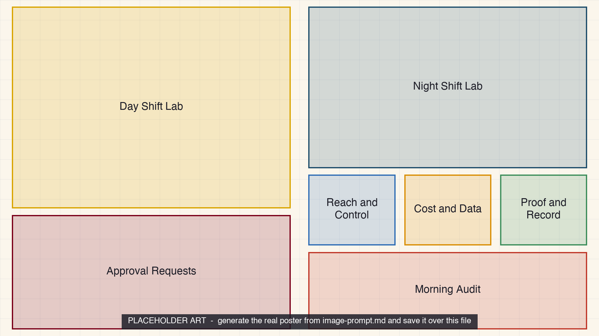

<iframe src="./main.html" height="1000px" width="100%" scrolling="no"></iframe>

[Open the interactive poster full screen](./main.html){ .md-button .md-button--primary }

Use **Explore** mode to hover over or click a panel and read what changes when an agent keeps working after you leave, and which criteria to apply. Use **Quiz** mode to read a clue and click the panel it describes.

The seven regions are:

1. **Day Shift Lab** — The researcher watches agents work and sees every action.
2. **Approval Requests** — Requests reach you while you are present, under an approval model.
3. **Night Shift Lab** — The same lab at night, with an agent working on its own cloud computer.
4. **Reach and Control** — Where it runs, blast radius, and the approval model.
5. **Cost and Data** — Usage metering, data exposure, and memory.
6. **Proof and Record** — Claim verification and the activity audit.
7. **Morning Audit** — Reading last night's log against the task the agent was given.

## Static Poster

{ loading=lazy }

The full-size poster above is a static copy of the interactive version, handy for printing, sharing, or viewing without JavaScript. Until the final artwork is generated, this image is placeholder art.

## Why This Matters

An always-on personal agent keeps its own cloud computer, signs in to tools as you, and works while you are away. That gives it standing access and no one watching, so the same questions as for any agent must hold for months and not minutes. Chapter 19 turns them into eight criteria: where it runs, blast radius, approval model, usage metering, data exposure, memory, claim verification, and activity audit. The last is a habit as much as a feature. Each morning, compare the log with the task the agent was given.

The poster teaches criteria and names no product, price, or ranking. The product facts in Chapter 19 are a snapshot of October 2026, almost all vendor-stated or reported in the press, and the research notes found no independent benchmarks or controlled tests. Prices, tiers, and features changed within weeks of launch. Check a vendor's own pages before relying on any detail, and test the claims that matter with synthetic data and a throwaway account.

## Connects to

- [Chapter 19: Always-On Personal Agents for Research](../../chapters/19-always-on-personal-agents/index.md)

## Source

The poster draws on Chapter 19 of this book and on the [Personal Agents appendix](../../appendices/personal-agents/index.md) that Chapter 19 cites. It uses the appendix for criteria only, not for prices or rankings.

Teachers and editors can open [calibration mode](./main.html?edit=true) to adjust zone positions after the artwork is generated. Copy only the `x1`, `y1`, `x2`, and `y2` numbers back into `data.json`, because the calibration export omits `showLabels` and `palette`.
