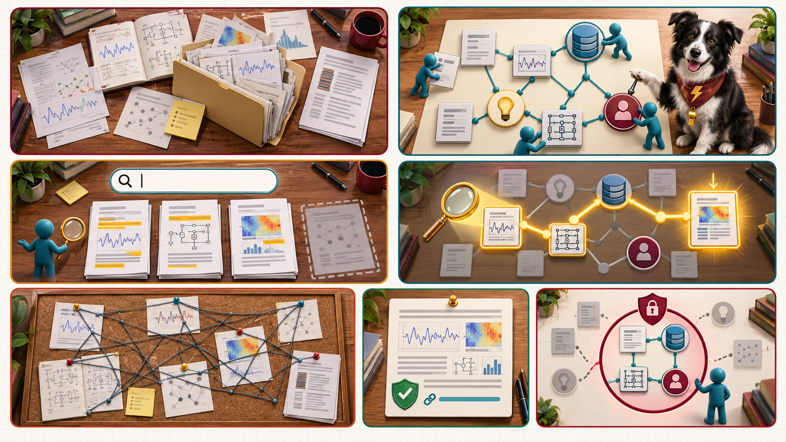

<iframe src="./main.html" height="1000px" width="100%" scrolling="no"></iframe>

[Open the interactive poster full screen](./main.html){ .md-button .md-button--primary }

Use **Explore** mode to hover over or click a panel and read what it shows. The left half is the folder of files. The right half is the same material as a graph. Use **Quiz** mode to read a clue and click the panel it describes.

The seven regions are:

1. **The Folder** — Papers, notes, results, and drafts with no recorded relationships.
2. **Keyword Search Only** — A search that finds the words you typed and misses the rest.
3. **Links That Mean Nothing** — Untyped links that let you navigate but not compute.
4. **Typed Nodes and Edges** — Entities with types, joined by named, directed relationships.
5. **A Three-Hop Question** — A path of three links that answers what no single note states.
6. **A Grounded Answer** — Facts from followed links placed in the prompt, so the answer can be checked.
7. **The Privacy Ring** — The part of the graph an agent may not read.

## Static Poster

{ loading=lazy }

The full-size poster above is a static copy of the interactive version, handy for printing, sharing, or viewing without JavaScript. Until the final artwork is generated, this image is placeholder art.

## Why This Matters

A model forgets everything between sessions, so the only memory a research project has is what you write down. A folder of linked files is a good memory for reading. It is a poor one for asking, because a question such as which papers depend on a corrupted dataset needs several links followed in order. Typed links turn the notes into a graph a program can traverse. The same graph can ground an agent's answer in facts you can check.

The same property has a cost. Whoever can query the graph can see it. Chapter 19 treats this as personal knowledge privacy: partition the graph by data class, give each agent a view of only what its job needs, and review what an agent writes back. The poster does not claim that a graph is always better than a folder. It claims that a graph is better for questions that follow relationships, and that the graph is only as good as its entities and links, which a human must review. The example graph is invented for illustration.

## Connects to

- [Chapter 6: Knowledge Bases, Personal Knowledge Graphs, and the Anatomy of an Agent Skill](../../chapters/06-knowledge-bases-skill-anatomy/index.md)
- [Chapter 19: Always-On Personal Agents for Research](../../chapters/19-always-on-personal-agents/index.md)

## Source

The linked chapters of this book, including the Personal Knowledge Graphs appendix that Chapter 6 cites for the idea that a little semantics goes a long way. The entities, relationships, and paper names in the poster come from the illustrative graph in Chapter 6.

Teachers and editors can open [calibration mode](./main.html?edit=true) to adjust zone positions after the artwork is generated. Copy only the `x1`, `y1`, `x2`, and `y2` numbers back into `data.json`, because the calibration export omits `showLabels` and `palette`.
