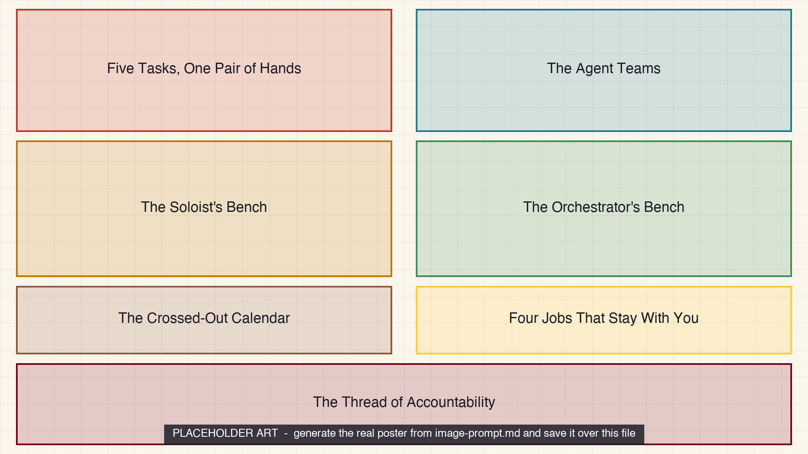

<iframe src="./main.html" height="1000px" width="100%" scrolling="no"></iframe>

[Open the interactive poster full screen](./main.html){ .md-button .md-button--primary }

Use **Explore** mode to hover over or click a panel and read how the soloist's way of working compares with the orchestrator's. Use **Quiz** mode to read a clue and click the panel it describes. The left half shows doing everything yourself. The right half shows directing a team.

The seven regions are:

1. **Five Tasks, One Pair of Hands** — The five everyday research tasks, all reached by one person in turn.
2. **The Agent Teams** — About 20 planning agents and 10 execution agents sharing the same tasks.
3. **The Soloist's Bench** — One researcher at a cluttered bench, taking every action by hand.
4. **The Orchestrator's Bench** — The same bench, tidy, with the researcher reviewing one item.
5. **The Crossed-Out Calendar** — The hours that doing every step personally consumes.
6. **Four Jobs That Stay With You** — Set direction, supply domain judgment, resolve conflicts, and decide what is true.
7. **The Thread of Accountability** — One unbroken line from the soloist to the orchestrator that ends at a signature.

## Static Poster

{ loading=lazy }

The full-size poster above is a static copy of the interactive version, handy for printing, sharing, or viewing without JavaScript. Until the final artwork is generated, the image is placeholder art.

## Why This Matters

Chapter 1 breaks research into five everyday tasks and shows that agents can take over much of the procedural work in each. The researcher's job then changes. It moves from typing every script to choosing what runs, checking what comes back, and signing the result. The book's working model uses roughly 20 planning agents and 10 execution agents, and it calls those numbers a design target, not a law.

The poster does not claim that agents make research faster in every case. The hour counts in Chapter 1 are illustrative, and a team is only worth running if you can review its output. Attention, not typing speed, is the scarce resource. Accountability does not move to the agents. Trust, but verify!

## Connects to

- [Chapter 1: Research Workflows and the Researcher as Orchestrator](../../chapters/01-research-workflows-orchestrator/index.md)
- [Chapter 10: Orchestrating Teams of Planning and Execution Agents](../../chapters/10-orchestrating-agent-teams/index.md)

## Source

Chapter 1 for the five tasks, the pipeline arithmetic, the productivity example, and the researcher as orchestrator. Chapter 10 for the planning and execution split, the attention budget, and conflict resolution. The hour counts and agent counts are the chapters' own illustrative figures.

Teachers and editors can open [calibration mode](./main.html?edit=true) to adjust zone positions after the artwork is generated. Copy only the `x1`, `y1`, `x2`, and `y2` numbers back into `data.json`, because the calibration export omits `showLabels` and `palette`.
