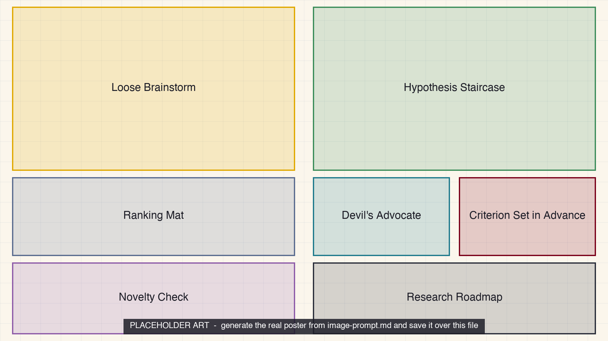

<iframe src="./main.html" height="1000px" width="100%" scrolling="no"></iframe>

[Open the interactive poster full screen](./main.html){ .md-button .md-button--primary }

Use **Explore** mode to hover over or click a panel and read what happens at that stage of turning a topic into a testable claim. Use **Quiz** mode to read a clue and click the panel it describes. Two staircases climb toward the same summit. The left one is loose and cloudy and ends in nothing. The right one is sharp and ends in a claim that a result could contradict.

The seven regions are:

1. **Loose Brainstorm** — Many cheap ideas, produced without judgment, none yet testable.
2. **Hypothesis Staircase** — Problem framed, claim stated, prediction written, measurement chosen, refuting result named.
3. **Ranking Mat** — Candidate ideas scored on weighted criteria, where the weights are the decision.
4. **Devil's Advocate** — A challenger prompt that asks what would make the idea wrong.
5. **Criterion Set in Advance** — The refuting result is decided before any data arrive.
6. **Novelty Check** — A search, and not a model's say-so, shows whether the idea is new.
7. **Research Roadmap** — A plan with decision points that say continue, change direction, or stop.

## Static Poster

{ loading=lazy }

The full-size poster above is a static copy of the interactive version, handy for printing, sharing, or viewing without JavaScript. Until the final artwork is generated, the image is placeholder art.

## Why This Matters

A language model will produce dozens of ideas in a minute, and it tends to agree with the person it is talking to. What it cannot do is decide which idea is worth months of your time. Chapter 14 keeps the volume with the agent and the choice with you. A statement counts as a hypothesis when it names a measurable quantity, a threshold, and conditions, so that some possible observation would contradict it. "Calibration makes the ADC better" cannot be wrong, so it cannot yet be tested.

The poster simplifies. The ranking example uses invented scores, and the scores change when the weights change. The roadmap numbers are illustrative. A falsifiable claim is necessary for research but not sufficient, because it must also be feasible, novel, and worth doing. The matrix on the poster uses the chapter's four criteria of impact, feasibility, novelty, and risk. Cost is part of feasibility in practice but is not a separate column in the chapter.

## Connects to

- [Chapter 14: Brainstorming and Problem Framing](../../chapters/14-brainstorming-problem-framing/index.md)
- [Chapter 11: AI-Assisted Literature Search and Synthesis](../../chapters/11-literature-search-synthesis/index.md)
- [Chapter 17: Verification and Reproducibility](../../chapters/17-verification-reproducibility/index.md)

## Source

- Chapter 14 supplies the framing, idea generation, hypothesis, experiment design, feasibility, ranking, novelty check, and roadmap material.
- Chapter 11 supplies the search pipeline used for the novelty check.
- Chapter 17 supplies the test-driven research habit of fixing criteria before the result is seen.

Teachers and editors can open [calibration mode](./main.html?edit=true) to adjust zone positions after the artwork is generated. Copy only the `x1`, `y1`, `x2`, and `y2` numbers back into `data.json`, because the calibration export omits `showLabels` and `palette`.
