# Interactive Infographic Posters

These posters turn the book's biggest ideas into full-width, classroom-ready pictures. Most set a risky way of working beside a controlled one, so the difference is visible at a glance. Open a poster, hover over or click a region to read what it shows, then switch to **Quiz** mode to test yourself.

The original concepts and their sources are in [Infographic Poster Ideas](./poster-ideas.md).

-   [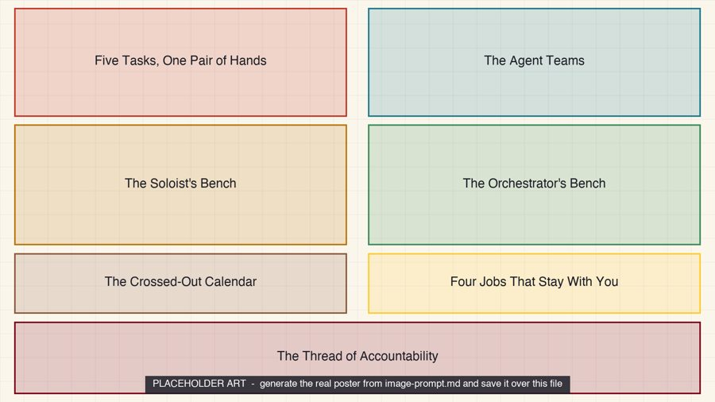](./from-doing-to-directing/index.md)

    **[From Doing Everything to Directing Everything](./from-doing-to-directing/index.md)**

    The researcher's job moves from doing every task by hand to directing a team of agents, while accountability for the science stays with the researcher. *Grid overlay, 7 regions.*

-   [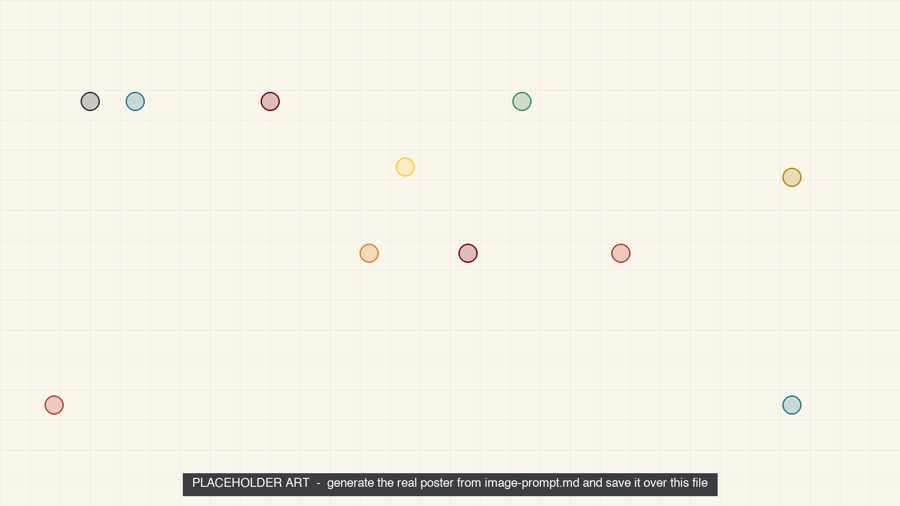](./the-window-that-fills-up/index.md)

    **[The Window That Fills Up](./the-window-that-fills-up/index.md)**

    A context window is one shared token budget, and when it overflows the oldest content can fall off silently, so subtract before you paste. *Callout overlay, 11 markers.*

-   [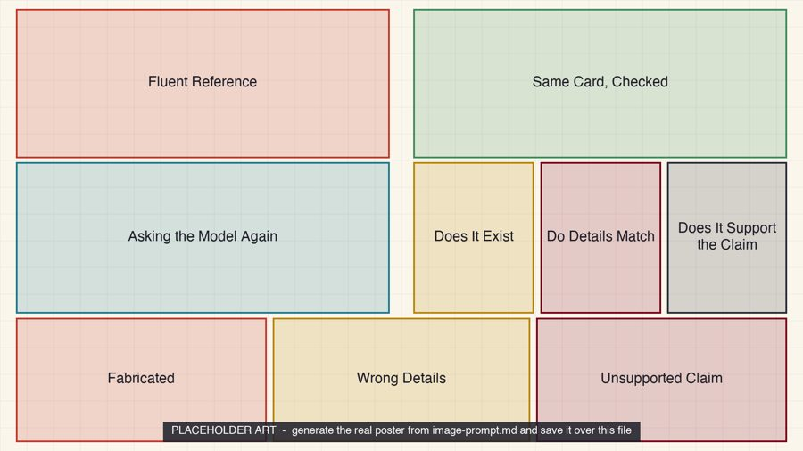](./real-citation-fluent-fake/index.md)

    **[The Real Citation and the Fluent Fake](./real-citation-fluent-fake/index.md)**

    A model writes a fabricated reference as fluently as a real one, so every citation needs three checks the model cannot perform on itself. *Grid overlay, 9 regions.*

-   [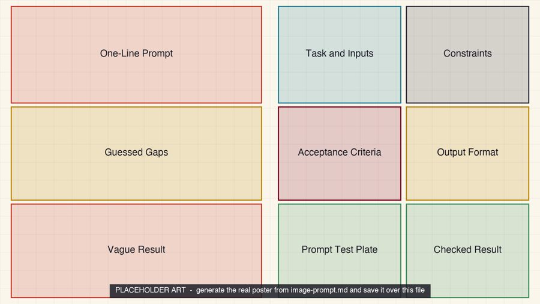](./vague-prompt-engineered-context/index.md)

    **[Vague Prompt, Engineered Context](./vague-prompt-engineered-context/index.md)**

    The same model with the same input file gives a vague answer from a one-line prompt and a checkable answer from an engineered context. *Grid overlay, 9 regions.*

-   [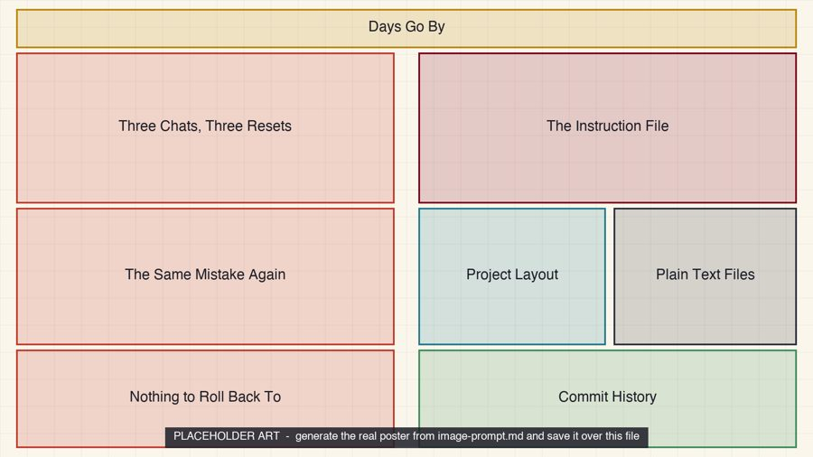](./chat-forgets-project-remembers/index.md)

    **[The Chat That Forgets, the Project That Remembers](./chat-forgets-project-remembers/index.md)**

    An agent starts every session with no memory, so a plain-text project file and a version history are what it reads first and what you can undo. *Grid overlay, 8 regions.*

-   [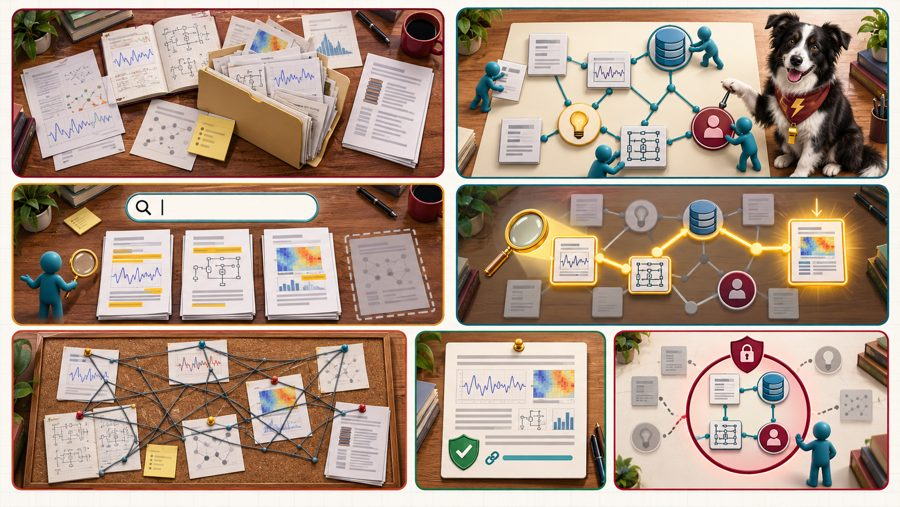](./folder-of-files-graph-of-knowledge/index.md)

    **[A Folder of Files, a Graph of Knowledge](./folder-of-files-graph-of-knowledge/index.md)**

    Files are for reading and a typed graph is for asking, and whoever can query the graph can see it, so an agent should get only the views its job needs. *Grid overlay, 7 regions.*

-   [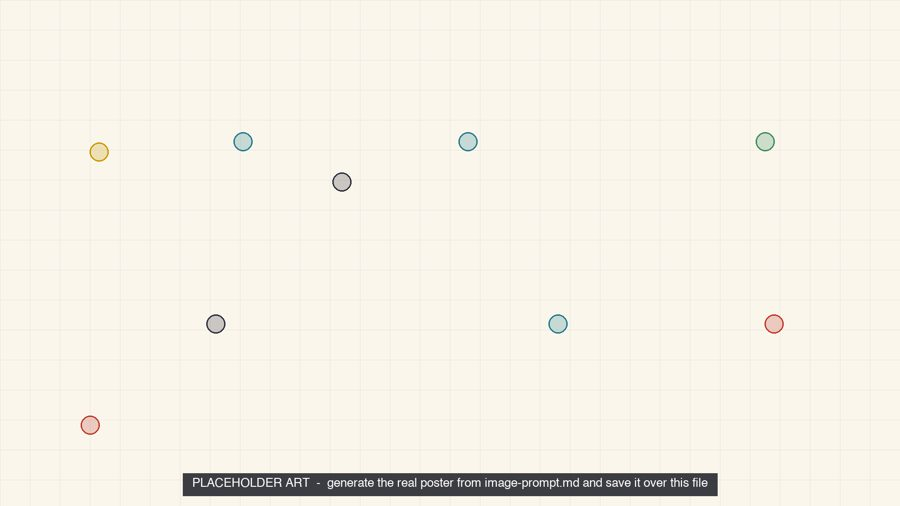](./inside-an-agent-skill/index.md)

    **[Inside an Agent Skill](./inside-an-agent-skill/index.md)**

    A skill is a folder with a front door, and only the name and description at that door are always in the agent's context. *Callout overlay, 9 markers.*

-   

    **[The Agent Loop Inside Its Sandbox](./agent-loop-inside-its-sandbox/index.md)**

    An agent is a loop of deciding, calling a tool, and observing the result, and its permissions decide how far one wrong turn can reach. *Callout overlay, 12 markers.*

-   [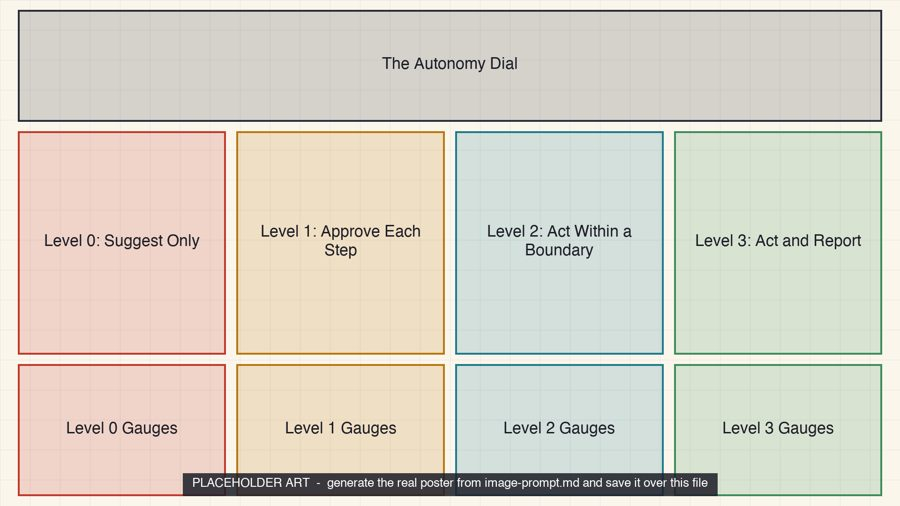](./the-autonomy-dial/index.md)

    **[The Autonomy Dial](./the-autonomy-dial/index.md)**

    How much an agent may do on its own depends on whether the task is reversible, whether the result leaves your control, and whether it can be checked quickly. *Grid overlay, 9 regions.*

-   [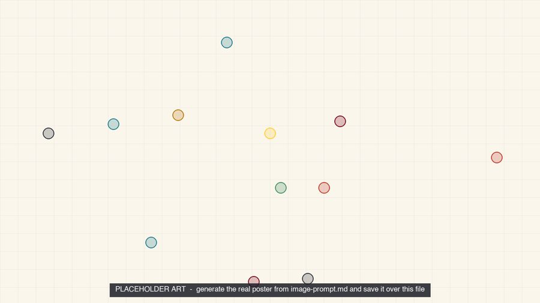](./twenty-planners-ten-doers/index.md)

    **[Twenty Planners, Ten Doers, One Researcher](./twenty-planners-ten-doers/index.md)**

    A team of about 20 planning agents and 10 execution agents needs queues, handoffs, and gates, and the scarcest thing on the stage is the researcher's attention. *Callout overlay, 12 markers.*

-   [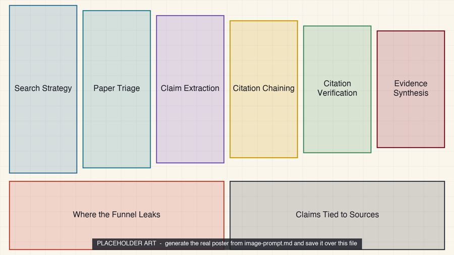](./the-literature-funnel/index.md)

    **[The Literature Funnel](./the-literature-funnel/index.md)**

    Agents make breadth cheap at every stage of a literature review, and verification is where the pipeline earns its keep. *Grid overlay, 8 regions.*

-   [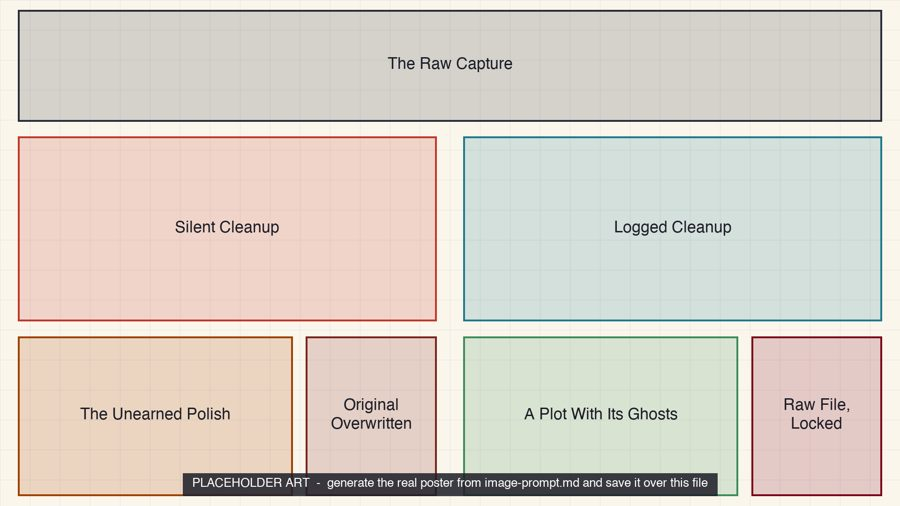](./cleaning-without-hiding/index.md)

    **[Cleaning Without Hiding](./cleaning-without-hiding/index.md)**

    A clean-looking dataset is not the same as a trustworthy one, so show what you removed and why. *Grid overlay, 7 regions.*

-   [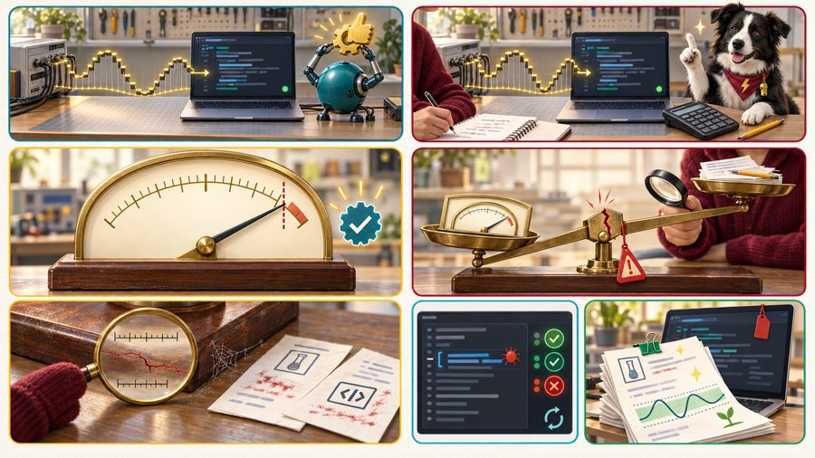](./code-that-runs-code-that-is-right/index.md)

    **[Code That Runs, Code That Is Right](./code-that-runs-code-that-is-right/index.md)**

    A script that finishes without an error can still return a wrong number, so check its answer against something you can compute independently. *Grid overlay, 7 regions.*

-   [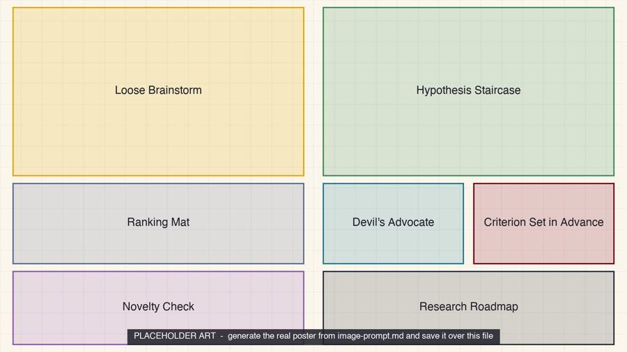](./hunch-to-falsifiable-hypothesis/index.md)

    **[From Hunch to Falsifiable Hypothesis](./hunch-to-falsifiable-hypothesis/index.md)**

    An idea only becomes research when a stated result could show it wrong, and the climb from a loose brainstorm to that claim has recognizable steps. *Grid overlay, 7 regions.*

-   [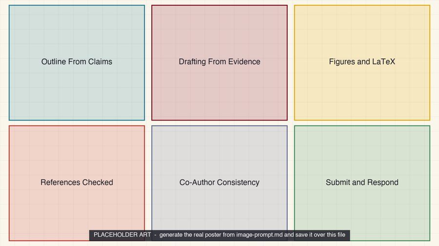](./the-manuscript-line/index.md)

    **[The Manuscript Line: Where the Human Stays](./the-manuscript-line/index.md)**

    An agent can draft and format a paper, but the claims, the interpretation, and the signature stay with the author. *Grid overlay, 6 regions.*

-   [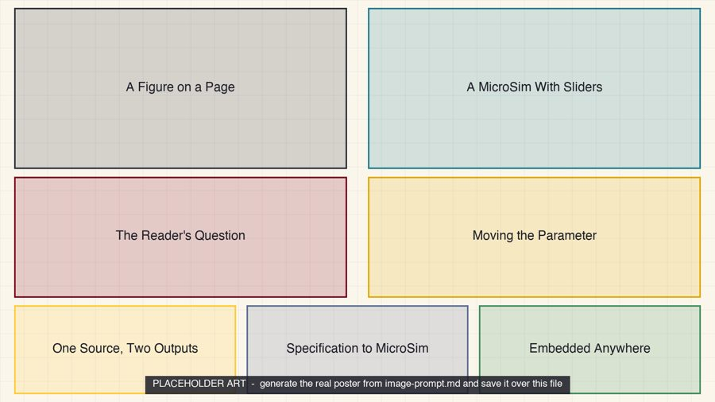](./figure-you-read-simulation-you-explore/index.md)

    **[A Figure You Read, a Simulation You Explore](./figure-you-read-simulation-you-explore/index.md)**

    A figure shows one case of a result, while a simulation built from the same result lets a reader ask what happens at other settings. *Grid overlay, 7 regions.*

-   [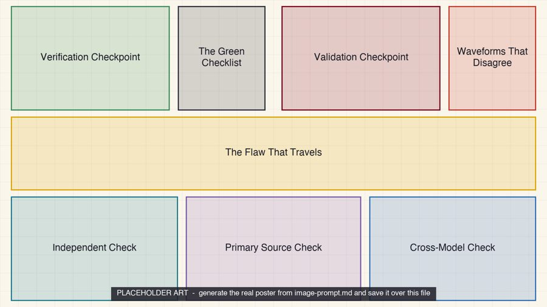](./verified-is-not-validated/index.md)

    **[Verified Is Not Validated](./verified-is-not-validated/index.md)**

    A design can pass every check against its specification and still be wrong, because verification asks whether it was built right and validation asks whether it was the right thing. *Grid overlay, 8 regions.*

-   

    **[Where Does Your Data Go?](./where-does-your-data-go/index.md)**

    Before you paste anything into an AI tool, decide what may leave the lab and where it goes, then write that decision into a one-page lab policy. *Grid overlay, 8 regions.*

-   [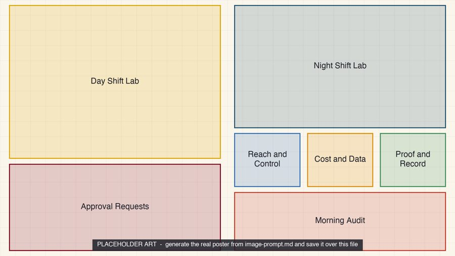](./day-shift-night-shift/index.md)

    **[Day Shift, Night Shift](./day-shift-night-shift/index.md)**

    An agent that works while you are away needs a morning review as much as a night shift needs a supervisor, and eight durable criteria tell you how to judge it. *Grid overlay, 7 regions.*

-   [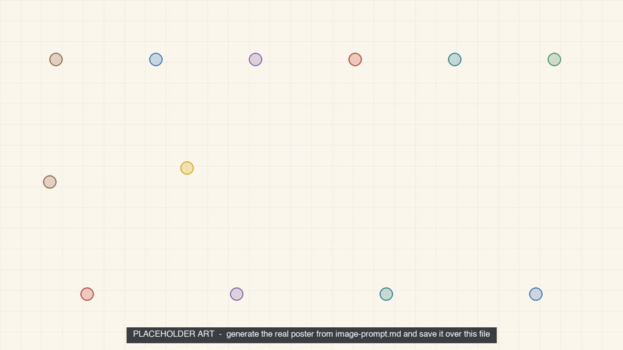](./the-paper-behind-the-book/index.md)

    **[The Paper Behind the Book](./the-paper-behind-the-book/index.md)**

    The skill pipeline that wrote this book and a paper about MicroSims shows that the pipeline is the documentation, because every stage leaves a file and every file has a check. *Callout overlay, 12 markers.*

