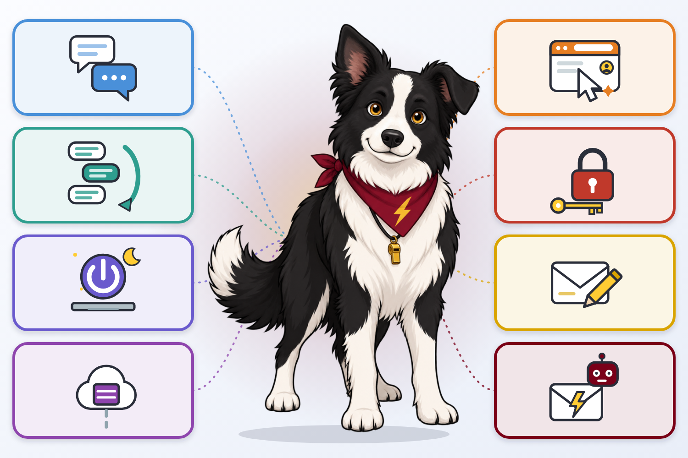

<!-- poster-art:begin -->
<iframe src="./main.html" height="800px" width="100%" scrolling="no"></iframe>

[Open the interactive poster full screen](./main.html){ .md-button .md-button--primary }
<!-- poster-art:end -->

Everything called a "chat" agent looks the same on screen: a box where you type. What differs is what sits behind the box. Use **Explore** mode to hover over a numbered marker or its label and read what that kind of agent can do and what it costs you in risk. Use **Quiz** mode to read a clue and click the matching tile. Volt, the border collie in the middle, stands for the agent itself; the tiles on the left describe how it runs and the tiles on the right describe what it can reach.

The eight callouts, in order from simplest to most capable, are:

1. **Simple Prompt/Response** — One prompt in, one response out, like the original ChatGPT.
2. **Multiple Questions** — Session management keeps earlier turns so follow-ups make sense.
3. **Always On** — The agent keeps working when your laptop is closed.
4. **Disconnected from Desktop** — The agent runs in a virtual machine in the cloud, not on your computer.
5. **Browser Takeover** — The agent can use your browser and the sites where you are already signed in.
6. **More Credential Access** — The agent holds passwords, keys, or tokens of its own.
7. **Email** — The agent can add drafts to your mailbox for you to review and send.
8. **Agent Email** — Each agent has its own email address.

Each step down the list gives the agent more reach, and each one needs a matching control: a fresh session, a sandbox, a separate account, a human who presses send.

<!-- poster-static:begin -->
## Static Poster

{ loading=lazy }

The full-size poster above is a static copy of the interactive version, handy for printing, sharing, or viewing without JavaScript.
<!-- poster-static:end -->
