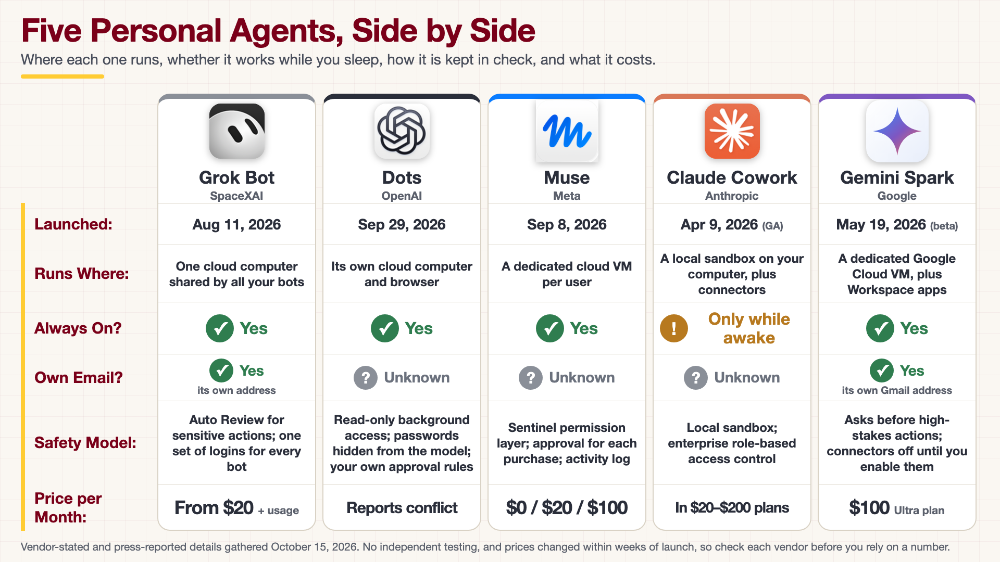

<!-- poster-art:begin -->
<iframe src="./main.html" height="1000px" width="100%" scrolling="no"></iframe>

[Open the interactive poster full screen](./main.html){ .md-button .md-button--primary }
<!-- poster-art:end -->

Use **Explore** mode to hover over or click a column and read what that agent does, how it is kept in check, and what it costs. Use **Quiz** mode to read a clue and click the agent it describes.

The five columns are:

1. **Grok Bot (SpaceXAI)** — A hosted agent whose bots share one cloud computer and one set of logins.
2. **Dots (OpenAI)** — A personal agent inside ChatGPT with its own cloud computer, read-only background access, and approval rules you can write.
3. **Muse (Meta)** — A consumer agent in a dedicated cloud VM, with a Sentinel permission layer and approval for each purchase.
4. **Claude Cowork (Anthropic)** — A tab in Claude Desktop that works in a local sandbox and is the least always-on of the five.
5. **Gemini Spark (Google)** — A consumer agent on dedicated Google Cloud VMs with its own Gmail address, built into Workspace and bundled with the Google AI Ultra tier.

<!-- poster-static:begin -->
## Static Poster

{ loading=lazy }

The full-size poster above is a static copy of the interactive version, handy for printing, sharing, or viewing without JavaScript.
<!-- poster-static:end -->

## Why This Matters

All five products arrived within about six months of each other in 2026, and they make the same promise: an agent that carries out multi-step work while you do something else. They differ in where the agent runs, who can see its logins, and how much it can do without asking. For a research group, those differences decide whether an agent can be trusted near unpublished data or a licensed tool chain. Read the Safety Model row before the Price row.

## Where the Numbers Come From

Every value on this poster comes from the [Personal Agent Software appendix](../../appendices/personal-agent-software/index.md), which is built from vendor announcements and press coverage gathered on October 15, 2026. We found no independent benchmarks or controlled tests of any of these products. Prices and tiers changed several times within weeks of launch, and the Dots price is reported two different ways, so confirm each number with the vendor. Open-source alternatives OpenClaw and Hermes Agent are covered in the appendix but are not on the poster, and so is Google's separate work-oriented Gemini Agent. The logos belong to their owners, except the Gemini Spark icon, which is a generic stand-in; the appendix lists where each one came from.

## Connects to

- [Appendix: Personal Agent Software](../../appendices/personal-agent-software/index.md)
- [Chapter 19: Always-On Personal Agents for Research](../../chapters/19-always-on-personal-agents/index.md)

## Source

The poster is rendered from [`poster.html`](https://github.com/dmccreary/ai-for-ee-research/blob/main/docs/posters/personal-agent-software/poster.html), not from an image model, because it prints real names, dates, prices, and logos. To change a value, edit that file, render it again, and update the matching text in `data.json`.

Teachers and editors can open [calibration mode](./main.html?edit=true) to adjust zone positions. Copy only the `x1`, `y1`, `x2`, and `y2` numbers back into `data.json`, because the calibration export omits `showLabels` and `palette`.
