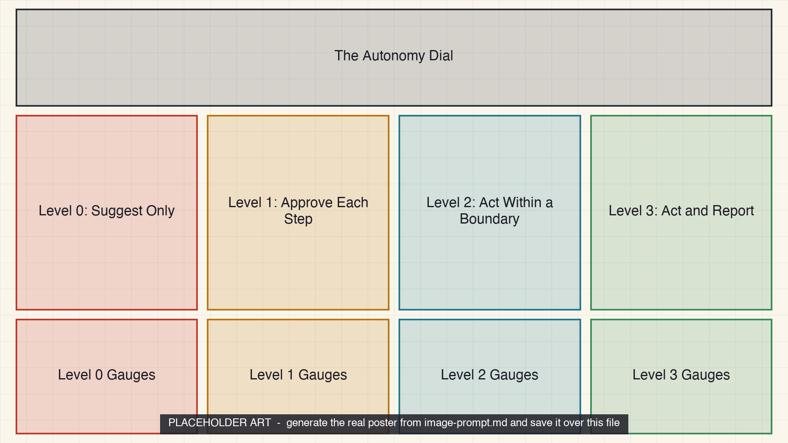

<!-- poster-art:begin -->
<iframe src="./main.html" height="1000px" width="100%" scrolling="no"></iframe>

[Open the interactive poster full screen](./main.html){ .md-button .md-button--primary }
<!-- poster-art:end -->

Use **Explore** mode to hover over or click a panel and read what each level of autonomy allows and why the gauges read as they do. Use **Quiz** mode to read a scenario and click the panel that shows it. The four columns run from level 0 on the left to level 3 on the right. Each column has a scene above and three gauges below.

The nine regions are:

1. **The Autonomy Dial** — Autonomy is a dial set task by task, not a switch for the whole project.
2. **Level 0: Suggest Only** — The agent proposes and the researcher performs the action.
3. **Level 0 Gauges** — Hard to undo, outward-bound, and hard to check.
4. **Level 1: Approve Each Step** — The agent acts only after each action is approved.
5. **Level 1 Gauges** — Hard to undo and outward-bound, but quick to check.
6. **Level 2: Act Within a Boundary** — The agent works freely inside a scope and stops at gates.
7. **Level 2 Gauges** — Reversible and local, but not quick to check.
8. **Level 3: Act and Report** — The agent runs unattended with a log and limits, then reports.
9. **Level 3 Gauges** — Reversible, local, and checked by a script.

<!-- poster-static:begin -->
## Static Poster

{ loading=lazy }

The full-size poster above is a static copy of the interactive version, handy for printing, sharing, or viewing without JavaScript.
<!-- poster-static:end -->

## Why This Matters

Chapter 9 treats autonomy as a dial and sets it per task from three properties of the task: reversibility, reach, and verifiability. A very capable model should still not send email unreviewed, and a modest one can safely reformat a bibliography. The poster follows the chapter's assignment rule from level 0 to level 3, with the chapter's own example task at each level.

The four levels are a convention of this book and not a standard, and the example tasks are illustrative. The poster does not say that level 3 means no supervision. An unattended agent still needs a narrow written scope, a log you read the next morning, and limits on steps, time, and spending. Trust, but verify!

## Connects to

- [Chapter 9: Supervising Agents and Defining Agent Roles](../../chapters/09-supervising-agents-roles/index.md)
- [Chapter 8: Agents, Tool Use, and Subagents](../../chapters/08-agents-tool-use-subagents/index.md)

## Source

Chapter 9, sections "Autonomy and Supervision", "Logging, Failure Modes, and Runaway Agents", and "Scheduling, Background Work, and Trust Boundaries", for the levels, the three properties, the assignment rule, and the example tasks. Chapter 8 for approval fatigue and version control as the safety net. Chapter 1 for the point that drafting is safe until you send.

Teachers and editors can open [calibration mode](./main.html?edit=true) to adjust zone positions after the artwork is generated. Copy only the `x1`, `y1`, `x2`, and `y2` numbers back into `data.json`, because the calibration export omits `showLabels` and `palette`.
