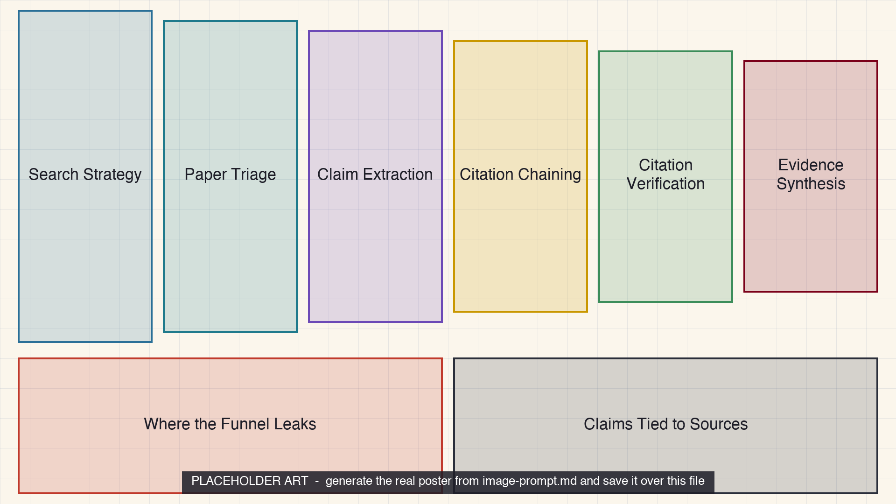

<iframe src="./main.html" height="1000px" width="100%" scrolling="no"></iframe>

[Open the interactive poster full screen](./main.html){ .md-button .md-button--primary }

Use **Explore** mode to hover over or click a panel and read what happens at that stage and what can go wrong there. Use **Quiz** mode to read a clue and click the panel it describes.

The eight regions are:

1. **Search Strategy** — The written procedure of questions, terms, databases, and filters.
2. **Paper Triage** — A rubric-based sort into read closely, skim, and set aside.
3. **Claim Extraction** — Checkable claims, each with its conditions and location.
4. **Citation Chaining** — Following references backward and citations forward.
5. **Citation Verification** — Looking up every reference to confirm it exists and matches.
6. **Evidence Synthesis** — Combining sources by comparing like with like.
7. **Where the Funnel Leaks** — The missed paper, the misread claim, and the fabricated reference.
8. **Claims Tied to Sources** — A table of claims with locations and the kind of evidence.

## Static Poster

{ loading=lazy }

The full-size poster above is a static copy of the interactive version, handy for printing, sharing, or viewing without JavaScript. Until the final artwork is generated, this image is placeholder art.

## Why This Matters

AI assistance changes the speed of every stage of the literature workflow and none of the standards. An agent can generate search terms, run queries, sort results against your rubric, and pull claims out of papers faster than you can read them. That is breadth, and it is cheap. What the agent cannot do for you is vouch for the result. It can write a well-formatted reference to a paper that does not exist, and it can summarize a paper from its abstract and its expectations.

So each stage has a check you keep: a logged search strategy, a rubric with reasons, a location for every claim, a lookup for every reference, and a table that compares like with like. The poster shows citation chaining as its own stage between extraction and verification. The chapter's numbered pipeline does not list it as a step, and presents chaining as a second way of finding papers that keyword searches miss. The poster does not claim that the pipeline finds every relevant paper. It claims that the pipeline makes its losses visible. The example claims and values are illustrative.

## Connects to

- [Chapter 11: AI-Assisted Literature Search and Synthesis](../../chapters/11-literature-search-synthesis/index.md)

## Source

The linked chapter of this book, including its search strategy, triage, claim extraction, citation chaining, verification, and synthesis sections. The extracted-claims values in the chapter are illustrative.

Teachers and editors can open [calibration mode](./main.html?edit=true) to adjust zone positions after the artwork is generated. Copy only the `x1`, `y1`, `x2`, and `y2` numbers back into `data.json`, because the calibration export omits `showLabels` and `palette`.
