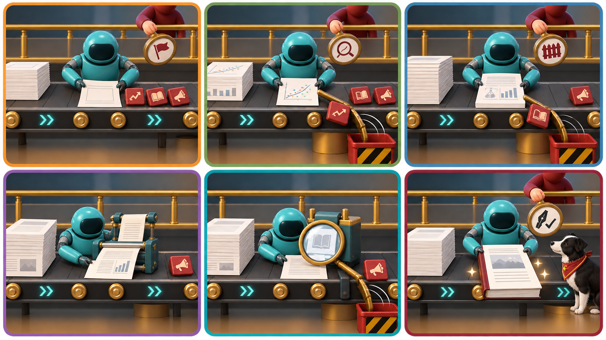

<!-- poster-art:begin -->
<iframe src="./main.html" height="1000px" width="100%" scrolling="no"></iframe>

[Open the interactive poster full screen](./main.html){ .md-button .md-button--primary }
<!-- poster-art:end -->

Use **Explore** mode to hover over or click a station and read what the agent does there and what the person keeps. Use **Quiz** mode to read a clue and click the station it describes. The line reads left to right across the top row, then left to right across the bottom row, as a paper grows from an outline to a submission. A gold handrail marks what stays human, and four stations carry a human stamp.

The six regions are:

1. **Outline From Claims** — An outline of claims, each tied to its evidence, with unsupported bullets marked.
2. **Drafting From Evidence** — The agent drafts only from supplied claims, and a number check follows each edit.
3. **Figures and LaTeX** — Figures regenerated from scripts, and LaTeX compiled after every substantial edit.
4. **References Checked** — Verified BibTeX entries, never retyped by hand.
5. **Co-Author Consistency** — Co-author review, with agent-proposed consistency fixes as a list.
6. **Submit and Respond** — The cover letter, the disclosure note, and a reviewer response that claims only real changes.

<!-- poster-static:begin -->
## Static Poster

{ loading=lazy }

The full-size poster above is a static copy of the interactive version, handy for printing, sharing, or viewing without JavaScript.
<!-- poster-static:end -->

## Why This Matters

A model can turn notes into prose faster than you can type, and prose that has not passed through your judgment is not your paper. Chapter 15 lets the agent draft and polish while every claim, every number, and the voice stay yours. It names three typical hazards: numbers that change during a revision, references that are fabricated or corrupted, and a drift toward claims larger than the evidence. Authorship carries accountability that a language model cannot take, so AI use is disclosed and an AI system is not listed as an author (Chapters 15 and 18).

The poster simplifies in three ways. It shows four human stamps, but a person should read every station, and the stamps mark the decisions that cannot be delegated. Pairing each hazard with one station is a teaching device, since several checks can catch the same error. And policies on disclosure differ and change, so read the current rules of your venue and institution at submission time.

## Connects to

- [Chapter 15: AI-Assisted Manuscript Preparation](../../chapters/15-manuscript-preparation/index.md)
- [Chapter 11: AI-Assisted Literature Search and Synthesis](../../chapters/11-literature-search-synthesis/index.md)
- [Chapter 18: Responsible and Ethical Use of AI](../../chapters/18-responsible-ethical-use/index.md)

## Source

- Chapter 15 supplies the paper structure, outline, drafting, revision, figures, LaTeX, references, co-author review, submission, and response material.
- Chapter 18 supplies the disclosure and authorship rules.
- Chapter 11 supplies the reference verification practice.

Teachers and editors can open [calibration mode](./main.html?edit=true) to adjust zone positions after the artwork is generated. Copy only the `x1`, `y1`, `x2`, and `y2` numbers back into `data.json`, because the calibration export omits `showLabels` and `palette`.
