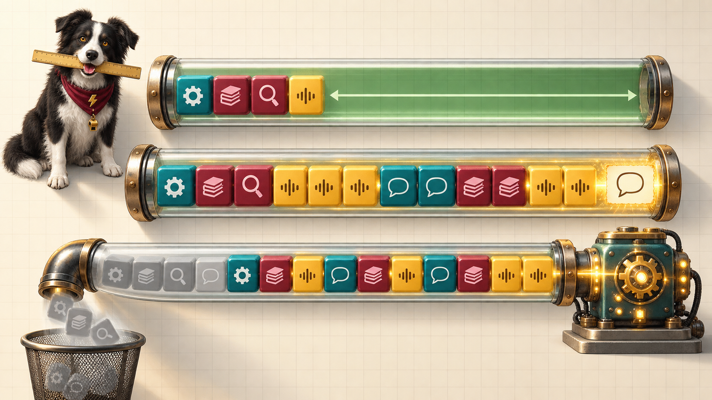

<!-- poster-art:begin -->
<iframe src="./main.html" height="1000px" width="100%" scrolling="no"></iframe>

[Open the interactive poster full screen](./main.html){ .md-button .md-button--primary }
<!-- poster-art:end -->

Use **Explore** mode to hover over a numbered marker or its label and read what that part of the window does. Use **Quiz** mode to read the name in the prompt, then click the marker that matches. The marker numbers are hidden, so you must find the matching part of the three tubes.

Read the poster from top to bottom. The top tube is comfortable. The middle tube is crowded after a second paste. The bottom tube has lost its oldest content without any warning.

The eleven callouts are:

1. **Budget Ruler** — The subtraction that tells you what is left.
2. **System Prompt** — Standing instructions that spend budget on every turn.
3. **The Paper Block** — A pasted document, counted in tokens.
4. **Token Meter** — Equations and code cost more tokens per word than prose.
5. **Middle Gets Overlooked** — Material in the middle of a long prompt is used less well.
6. **Room for the Answer** — The space the completion draws from the same pool.
7. **Silent Overflow** — The oldest content slides off and nothing looks wrong.
8. **Conversation History** — Earlier turns, resent each time, that pile up.
9. **The Second Paste** — The step that fills the window.
10. **Cut-Off Answer** — A reply that stops partway because the window is full.
11. **Model Working Unaware** — The model carries on without what it lost.

<!-- poster-static:begin -->
## Static Poster

{ loading=lazy }

The full-size poster above is a static copy of the interactive version, handy for printing, sharing, or viewing without JavaScript.
<!-- poster-static:end -->

## Why This Matters

A model can only use what is in its window, and the completion draws from the same pool as the prompt. Chapter 2 gives the arithmetic: the window minus the system prompt, history, attachments, and your message is what remains for the answer. In the chapter's worked example a 32,000-token window handles one 11,000-token paper comfortably and cannot finish a 6,000-token summary after a second paper. The dangerous case is the quiet one, where many tools drop the oldest content instead of reporting an error.

The poster is a schematic. The block widths are roughly to scale for the chapter's illustrative numbers, and the glow across the papers shows the chapter's point that the middle of a very long prompt is used less well, not a measurement. Real window sizes differ by model and change with each release, so look up the current figure in the provider's documentation. Chapter 4 covers what to do about it: select, summarize, compress, and restart with a short summary.

## Connects to

- [Chapter 2: How Language Models Work](../../chapters/02-how-language-models-work/index.md)
- [Chapter 4: Context Engineering and Advanced Prompting](../../chapters/04-context-engineering-prompting/index.md)

## Source

The linked chapters of this book, which supply the window arithmetic, the words-to-tokens estimate, the three overflow outcomes, and the context-management practices. All token counts are the chapters' illustrative numbers.

Teachers and editors can open [calibration mode](./main.html?edit=true) to drag the markers and copy updated coordinates. Copy only the `x` and `y` numbers back into `data.json` after the artwork is generated.
