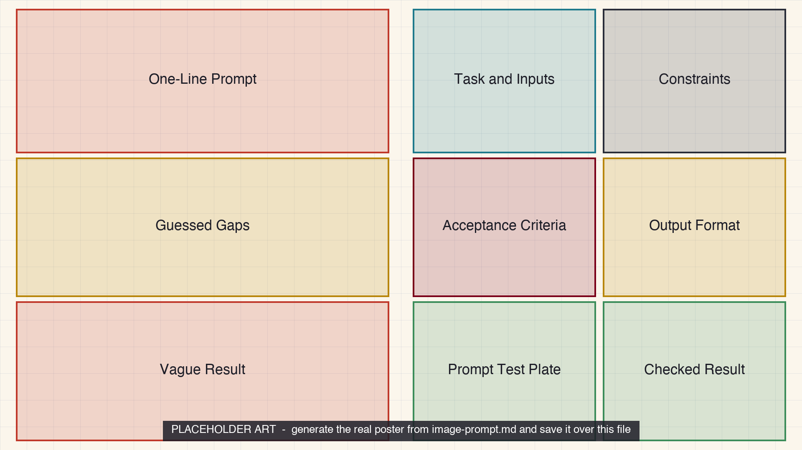

<iframe src="./main.html" height="1000px" width="100%" scrolling="no"></iframe>

[Open the interactive poster full screen](./main.html){ .md-button .md-button--primary }

Use **Explore** mode to hover over or click a panel and read what it adds to the prompt and why. Use **Quiz** mode to read a clue and click the panel it describes.

The left half is the vague prompt and what it leaves to chance. The right half is the same task with the context engineered. The model, the laptop, and the input file are the same on both sides.

The nine regions are:

1. **One-Line Prompt** — A short request with everything else left in the researcher's head.
2. **Guessed Gaps** — The choices the model makes wherever the prompt is silent.
3. **Vague Result** — A fluent answer that cannot be checked or used.
4. **Task and Inputs** — The goal, a role, the source material, and the definitions of terms.
5. **Constraints** — Limits on sources and scope, plus a sanctioned way to say not stated.
6. **Acceptance Criteria** — Testable conditions written before the prompt is run.
7. **Output Format** — A known shape that a script or a glance can validate.
8. **Prompt Test Plate** — A fixed set of samples run through the prompt after every change.
9. **Checked Result** — A grounded answer with its limits and assumptions stated.

## Static Poster

{ loading=lazy }

The full-size poster above is a static copy of the interactive version, handy for printing, sharing, or viewing without JavaScript. Until the final artwork is generated, this image is placeholder art.

## Why This Matters

Chapter 3 treats a prompt as a specification and Chapter 4 widens that to the whole input: what is present, what is absent, and how you will know the result is acceptable. The idea is that a weak result is often the apparatus, not the instrument. In Chapter 4's worked example, the same model and the same request gave a different and useful answer once the procedure section, a definition, and a standing instruction were added. Nothing about the model changed. Only the input did.

The poster does not promise that an engineered context makes a model correct. Source grounding, chain of thought, and self critique help but do not replace an external check, which is the subject of Chapter 17. The ENOB criteria and the paper-summary example are the chapters' own illustrative cases, not measured results.

## Connects to

- [Chapter 3: Choosing Models and Writing Clear Prompts](../../chapters/03-models-and-prompt-basics/index.md)
- [Chapter 4: Context Engineering and Advanced Prompting](../../chapters/04-context-engineering-prompting/index.md)

## Source

The linked chapters of this book, which supply the prompt techniques, the five-part task specification, the acceptance-criteria example, and the guidance on prompt testing. All values in the examples are the chapters' illustrative numbers.

Teachers and editors can open [calibration mode](./main.html?edit=true) to adjust zone positions after the artwork is generated. Copy only the `x1`, `y1`, `x2`, and `y2` numbers back into `data.json`, because the calibration export omits `showLabels` and `palette`.
