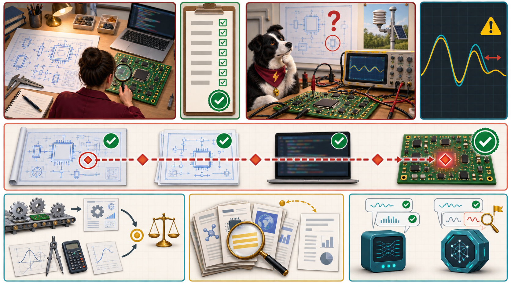

<iframe src="./main.html" height="1000px" width="100%" scrolling="no"></iframe>

[Open the interactive poster full screen](./main.html){ .md-button .md-button--primary }

Use **Explore** mode to hover over or click a panel and read what it shows about verification, validation, and the checks that sit between them. Use **Quiz** mode to read a clue and click the panel it describes.

The eight regions are:

1. **Verification Checkpoint** — An inspector checks the board and code against the blueprint.
2. **The Green Checklist** — Every line is ticked, and the ticks only vouch for the build.
3. **Validation Checkpoint** — The same board on a real bench, facing the real problem.
4. **Waveforms That Disagree** — The measured trace and the simulated trace do not match.
5. **The Flaw That Travels** — A small flaw in the blueprint rides through every verified stage.
6. **Independent Check** — The same quantity computed by a route with different failure causes.
7. **Primary Source Check** — Going to the original paper, datasheet, or standard.
8. **Cross-Model Check** — Asking a different model or a fresh session and comparing.

## Static Poster

{ loading=lazy }

The full-size poster above is a static copy of the interactive version, handy for printing, sharing, or viewing without JavaScript. Until the final artwork is generated, this image is placeholder art.

## Why This Matters

Verification asks whether the work was done right. Validation asks whether the right thing was done. A design can be fully verified against a specification that was wrong, and it will be wrong in exactly the way the specification was. Agents make this easy to miss, because an agent will faithfully implement the question as you stated it. If the question was framed badly, every verified result answers the wrong thing.

The three checks on the poster all guard the verification side. An independent check has failure causes different from the thing checked. A primary source check goes to the original document. A cross-model check is a cheap screen in which agreement is weak evidence and disagreement is a flag. None of them settles validation on its own. The poster does not claim any check proves a result is true. It shows which question each check can answer. The numbers in the chapter's examples are illustrative.

## Connects to

- [Chapter 17: Verification and Reproducibility](../../chapters/17-verification-reproducibility/index.md)

## Source

The poster draws on Chapter 17 of this book, and on Chapters 2, 11, and 14 where that chapter points back to them.

Teachers and editors can open [calibration mode](./main.html?edit=true) to adjust zone positions after the artwork is generated. Copy only the `x1`, `y1`, `x2`, and `y2` numbers back into `data.json`, because the calibration export omits `showLabels` and `palette`.
