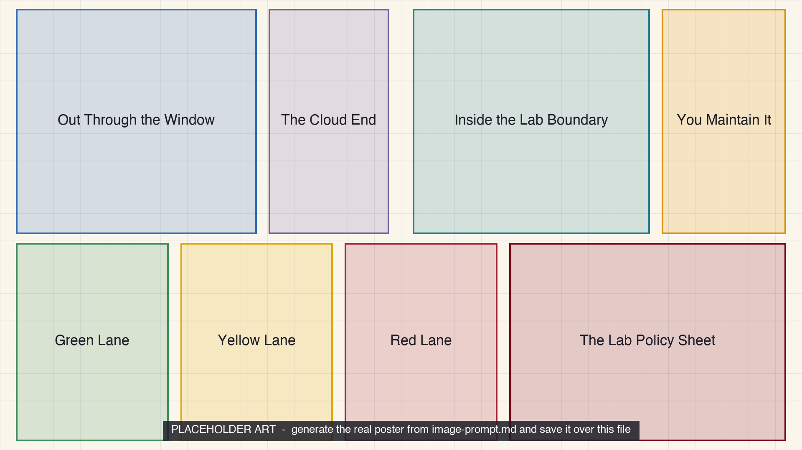

<!-- poster-art:begin -->
<iframe src="./main.html" height="1000px" width="100%" scrolling="no"></iframe>

[Open the interactive poster full screen](./main.html){ .md-button .md-button--primary }
<!-- poster-art:end -->

Use **Explore** mode to hover over or click a panel and read where data goes when you use a hosted model, what changes when you run one yourself, and how to sort documents before you paste. Use **Quiz** mode to read a clue and click the panel it describes.

The eight regions are:

1. **Out Through the Window** — A hosted model sends your documents out of the lab.
2. **The Cloud End** — At the far end, the provider's terms decide retention, access, and training.
3. **Inside the Lab Boundary** — A model you run keeps documents inside the lab.
4. **You Maintain It** — Self-hosting brings setup, security, and upkeep work.
5. **Green Lane** — Public material that may go to any tool.
6. **Yellow Lane** — Internal and unpublished material that needs a decision first.
7. **Red Lane** — Obligated data that stays off hosted tools.
8. **The Lab Policy Sheet** — The one-page lab AI policy that writes the rules down.

<!-- poster-static:begin -->
## Static Poster

{ loading=lazy }

The full-size poster above is a static copy of the interactive version, handy for printing, sharing, or viewing without JavaScript.
<!-- poster-static:end -->

## Why This Matters

Placing unpublished results in a hosted AI tool is a disclosure to a third party under the provider's terms, and a disclosure cannot be undone. Research holds more than your own results: participants' personal data, sponsor data, and vendor files under non-disclosure agreements. The remedy is a small classification that people can apply without looking it up, and a one-page lab policy that says which class may go to which tool.

The three traffic-light lanes simplify the four data classes of Chapter 18, and the classification there is illustrative. Policies on AI use, data protection, export control, and ownership differ between institutions, funders, journals, and countries, and they change. This poster is not legal advice. It also does not rank any product. Chapter 19 teaches the questions to ask of any hosted or self-hosted agent, and the claims it records about products are vendor-stated.

## Connects to

- [Chapter 18: Responsible and Ethical Use of AI](../../chapters/18-responsible-ethical-use/index.md)
- [Chapter 19: Always-On Personal Agents for Research](../../chapters/19-always-on-personal-agents/index.md)

## Source

The poster draws on Chapters 18 and 19 of this book. Chapter 19 draws its product facts from the [Personal Agents appendix](../../appendices/personal-agents/index.md), which records vendor-stated claims and press reports and found no independent tests.

Teachers and editors can open [calibration mode](./main.html?edit=true) to adjust zone positions after the artwork is generated. Copy only the `x1`, `y1`, `x2`, and `y2` numbers back into `data.json`, because the calibration export omits `showLabels` and `palette`.
