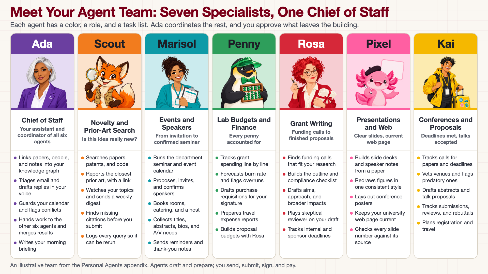

<!-- poster-art:begin -->
<iframe src="./main.html" height="1000px" width="100%" scrolling="no"></iframe>

[Open the interactive poster full screen](./main.html){ .md-button .md-button--primary }
<!-- poster-art:end -->

Use **Explore** mode to hover over or click a column and read what that agent does and where it stops. Use **Quiz** mode to read a job description and click the agent who does it.

The seven columns are:

1. **Ada: Chief of Staff** — Your assistant and the coordinator of all six other agents. Ada keeps your knowledge graph, email, and calendar.
2. **Scout: Novelty and Prior-Art Search** — Searches papers, patents, and code to answer "is this idea really new?"
3. **Marisol: Events and Speakers** — Runs the department seminar calendar and the speaker pipeline, from invitation to confirmation.
4. **Penny: Lab Budgets and Finance** — Tracks grant spending, forecasts overruns, and drafts purchase requests and expense reports.
5. **Rosa: Grant Writing** — Finds funding calls and drafts, critiques, and tracks proposals through the deadline.
6. **Pixel: Presentations and Web** — Builds slide decks, posters, and figures, and keeps your university web page current.
7. **Kai: Conferences and Proposals** — Tracks calls for papers, vets venues, and drafts abstracts, talk proposals, and travel.

<!-- poster-static:begin -->
## Static Poster

{ loading=lazy }

The full-size poster above is a static copy of the interactive version, handy for printing, sharing, or viewing without JavaScript.
<!-- poster-static:end -->

## Why This Matters

One general-purpose assistant that does everything is hard to check, because you cannot tell which of its jobs went wrong. A team of narrow agents is easier to supervise: each has one job, one color, one task list, and clear rules about what it does alone, what it asks about first, and what it never does. Seeing the whole team in one picture shows where the work is divided, and where the hand-offs are, such as Scout's prior-art summary feeding Rosa's proposal or Kai's travel estimate feeding Penny's budget. In every column the pattern is the same: the agent drafts and prepares, and a person sends, submits, signs, and pays.

## Where the Content Comes From

The team is a sample, not a product. The roles, tasks, and approval rules come from the character sheets in the [Personal Agents appendix](../../appendices/personal-agents/index.md), which the author wrote as a design for a researcher's dashboard. Nothing on this poster describes a tested system, and the sample tasks and numbers in the sheets are illustrative. The avatars are AI-generated illustrations made from the image prompts in those sheets.

## Connects to

- [Chapter 19: Always-On Personal Agents for Research](../../chapters/19-always-on-personal-agents/index.md)
- [Personal Agents appendix](../../appendices/personal-agents/index.md)

## Source

The poster is rendered from [`poster.html`](https://github.com/dmccreary/ai-for-ee-research/blob/main/docs/posters/your-agent-team/poster.html), not from an image model, because it prints real text. To change a name, role, or task, edit that file, render it again, and update the matching text in `data.json`.

Teachers and editors can open [calibration mode](./main.html?edit=true) to adjust zone positions. Copy only the `x1`, `y1`, `x2`, and `y2` numbers back into `data.json`, because the calibration export omits `showLabels` and `palette`.
