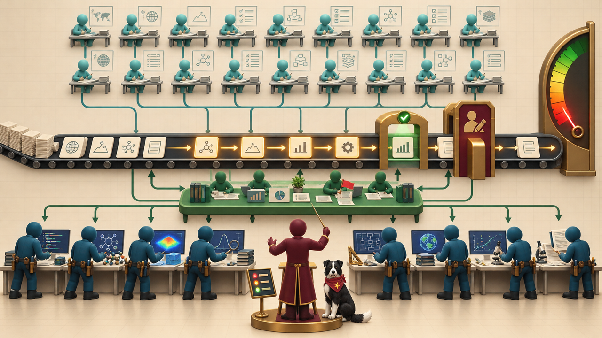

# List of Slide Decks

There are two slide decks here.  The first one called "Static Overview"
was autogenerated and uses the MARP (Markdown Presentation Ecosystem) standard.
The slides are all static lists and images.

The second slide deck called "MicroSims" includes dynamic content that includes MicroSims where you can interact with many slides.

-   **[AI for EE Research — Static Overview](./overview/index.md)**

    

    A 20-slide overview of the whole textbook: the researcher-as-orchestrator idea, the five parts of the book, and the key takeaways of all 20 chapters.

-   **[AI for EE Research — MicroSims](./overview-microsims/index.md)**

    

    A talk on AI for research productivity that embeds live MicroSims and interactive posters: the research funnel, the researcher as orchestrator, agent personas, and what a personal agent setup costs per month.

