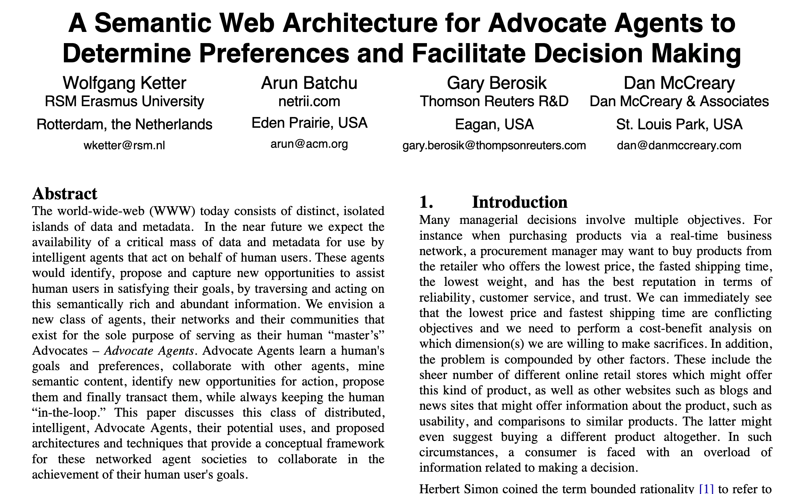
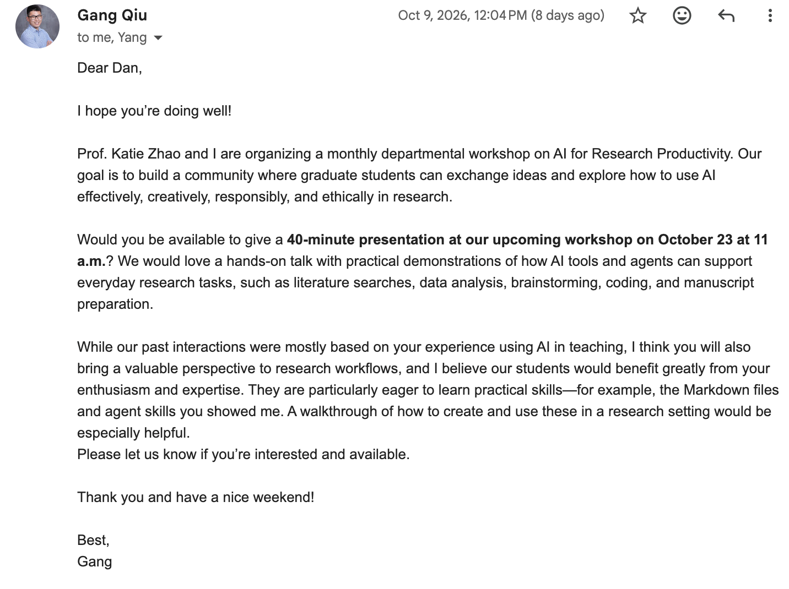
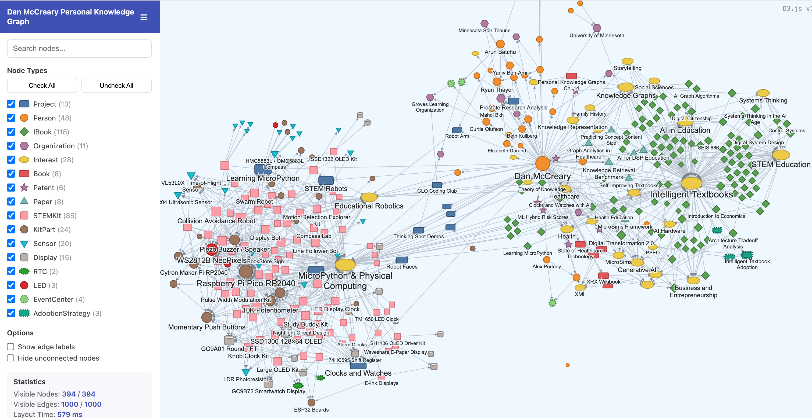
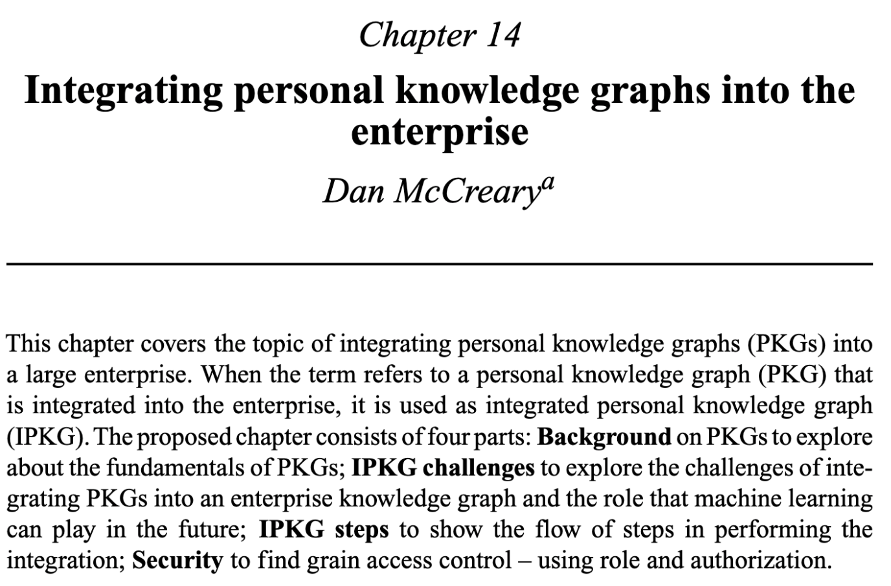
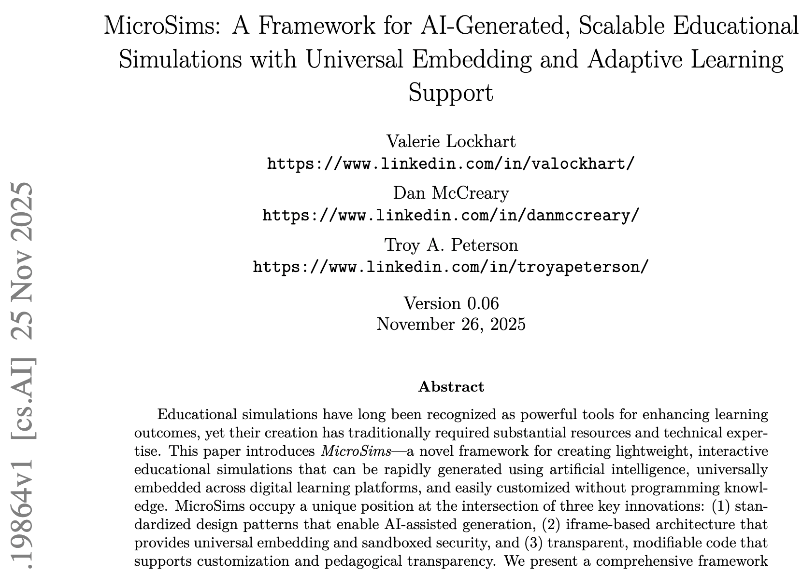

# AI for EE Research Productivity

- Dan McCreary (class of '83)
- University of Minnesota
- Department of Electrical Engineering and Computer Design
- October 23rd, 2026
- LinkedIn: [https://www.linkedin.com/in/danmccreary/](https://www.linkedin.com/in/danmccreary/)

---
## About Dan McCreary

- BA in Physics/Computer Science from Carleton College in 1982
- MSEE in Electrical Engineering/Computer Science from the University of Minnesota in 1983
- DSP design at Bell Laboratories
- Supercomputing software (Unix)
- Worked for Steve Jobs at NeXT Computer
- Founded Integrity Solutions (software services)
- Data exchange standards for State of Minnesota
- NoSQL Conferences and NoSQL textbook
- Distinguished Engineer at UGH/Optum
- Head of AI for TigerGraph (Silicon Valley)
- Knowledge representation strategies for education
- Using GenAI to create MicroSims and Intelligent Textbooks

*The key to artificial intelligence is knowledge representation*

---
## Thinking About Personal Agents Since 2008

---
## The Seed Email

{ width="300px" align="right"}

**From:** Gang Qiu 
**Date:** October 9th, 2026 

Prof. Katie Zhao and I are organizing a monthly departmental workshop on AI for Research Productivity. Our goal is to build a community where graduate students can exchange ideas and explore how to use AI effectively, creatively, responsibly, and ethically in research.

Would you be available to give a 40-minute presentation at our upcoming workshop?
...
---

## My Response

### Title: From Researcher to Orchestrator: Managing a Team of AI Agents for Research

### Abstract:
What if every researcher managed a team of 30 AI agents? In this hands-on talk I will describe a working model of research productivity in which each researcher coordinates 20 planning agents (which explore literature, decompose problems, and draft specifications) and 10 execution agents (which write code, run analyses, build simulations, and prepare figures and manuscripts). The researcher’s job shifts from doing every task to setting direction, supplying domain judgment, and reviewing results.

I will make this concrete with case studies from my own work, including interactive simulations and a full arXiv paper produced with AI agents, and a live demonstration of the two practical building blocks students asked about: plain Markdown files that capture a project’s goals and conventions, and reusable agent skills that turn a repeatable research task into a one-line command. We will also discuss how to keep this work responsible and ethical: verifying outputs, citing sources, and keeping the human accountable for the science.

---

## Meet Volt: Your Guide to Research Agents

{ width="280px" align="right" }

**Volt** is our session mascot. This border collie herds a flock of agents, and will guide us through setting up and using agents for EE research.

*"Sorry Goldie (the gopher), not today."*

---

## The Problem: Research Funnel

<iframe src="../../sims/research-funnel/main.html" height="582px" width="100%" scrolling="no"></iframe>

---

## The Solution: Researcher as Orchestrator

<iframe src="../../posters/twenty-planners-ten-doers/main.html" height="900px" width="100%" scrolling="no"></iframe>

---

## Many Types of "Chat" Agents

<iframe src="../../posters/many-types-of-chat-agents/main.html" height="900px" width="100%" scrolling="no"></iframe>

---
## Important New Term

**Task Completion Time Horizon**

The length of task, measured by how long a human expert needs to do it, that an AI agent completes successfully at a stated reliability.

- **50% time horizon:** tasks of this length succeed half the time
- **80% time horizon:** tasks of this length succeed four times out of five
- It measures the task's length in human time, not how long the agent runs
- Example (METR, April 2026): Claude Opus 4.6 is about 12 hours at 50% and about 70 minutes at 80%
- Similar to Moore's Law, but for agentic capability: the horizon keeps doubling every few months

---

## Projecting AI Task Completion to 2030

<iframe src="../../sims/projecting-ai/main.html" height="762px" width="100%" scrolling="no"></iframe>

---
## What Does Dan Use His Agents For?

1. Generation of interactive intelligent textbooks from a course description (10,000 hour task in 10 hours)
2. Generating simulations that live within these textbooks (MicroSims)
3. Generating reports, presentations and papers on EdTech topics
4. Helping my mentorship program - 12 active mentees doing six week crash course in AI
5. Helping build my Coding Club hand-on kits (Smart Clock)
6. Promoting books, microsims and interactive infographic posters
7. Scheduling and calendaring
8. Summarize research papers on knowledge representation
9. Designing signal process using DSP algorithms on Microcontrollers
10. Ordering low-costs parts for STEM Kits
11. Assisting local friends start their own companies

---
## Using Agent Personas to Divide Tasks

<iframe src="../../posters/your-agent-team/main.html" height="760px" width="100%" scrolling="no"></iframe>

---
## Agent-Agent Communication Strategies

**Start simple:** have agents communicate through shared files or a structured message format (Markdown), with **one** orchestrator (aka nexus agent) coordinating.  Only add complex protocols only when you outgrow that.

A practical progression:

1. **Orchestrator + subagents** - One lead agent delegates tasks and collects results. This is the easiest to debug and covers most use cases.
2. **Shared workspace** - Agents read and write files (Markdown or JSON) in a common folder or repo. It leaves an audit trail and needs no special infrastructure.
Structured messages. Agree on a small schema, such as {from, to, task, status, payload}, so agents don’t parse free-form prose from each other.
3. **Standard protocols as you scale** Use MCP, Publish/Subscribe messaging, or MQTT (hardware protocol notification from devices) to give agents shared tools and data. Use A2A (agent-to-agent) when agents from different systems or vendors must discover and call each other.
---
## Number One Question: Sharing Knowledge

How do you efficiency get all your Bots to communicate together as well as communicate with
the agents in your department and at the University of Minnesota?

**Recall:** *The key to artificial intelligence is knowledge representation*

<iframe src="../../posters/communication-hub/main.html" height="800px" width="100%" scrolling="no"></iframe>

---

## The Key: Personal Knowledge Graph

A central "ground truth" data structure to keep your content aligned with your goals.

---
## Enterprise Knowledge and the RBAC Rules
{ align="right" width="300"}

1. Getting agents access to the minimal data they need to do their work is complex
2. Integrating personal knowledge into a research community is complex
3. PKG/EKG integration opens many questions about intellectual property (IP) ownership
4. See [references](../../references.md) for details
---
## Agent Skills: Teach Your Agent a Repeatable Task

A **skill** is a reusable package of instructions that lets an agent do one defined task the same way every time.

- A folder with a `SKILL.md` file: a name, a one-line description, and step-by-step instructions
- Optional scripts, reference files, and templates in the same folder
- The agent keeps only the name and description in context, and loads the rest when a request matches
- Turns a repeatable research task into a one-line command
- Example: a skill that extracts Bode-plot features from measurement files
- Dan's experience: 100x quality improvement in textbook generation

<iframe src="../../posters/inside-an-agent-skill/main.html" height="1000px" width="100%" scrolling="no"></iframe>

---
## Generating a Publishing Quality Paper

{ width="500px" align="right"}

- Ask your GenAI tool what the best practices are
    - Length of paper
    - Typical outline
    - How many figures
    - How many references
    - Provide a template
    - Create a `build.sh` script
    - `build.sh` produces a `main.pdf`

---
## Sample Agent Architecture

<iframe src="../../sims/desktop-setup/main.html" height="750px" width="100%" scrolling="no"></iframe>

---
## How Much Does it Cost Per Month?

<iframe src="../../posters/dans-desktop/main.html" height="750px" width="100%" scrolling="no"></iframe>

---
## Agent Knowledge Graph Update Architecture

<iframe src="../../sims/agent-knowledge-graph-updates/main.html" height="532px" width="100%" scrolling="no"></iframe>

---
## Security/Ethics/Legal Issues

1. What security risks are introduced by agents?
2. Who is responsible for agent accountability?
3. What is the liability of the person that created the agents vs. the LLM vendor?
4. What are the ethics of agents using your credentials?
5. Who owns the Intellectual Property created by agents running "at the edge"? (Researcher, Software Developer, University)
6. What are the current policies about disclosing agents were used to generate the first draft of a paper?
7. How will increased agent activities strain university resources?
8. How much additional environmental damage will agents cause?
9. Will swarms of agents cause unemployment for grad students?
10. When do we shut down rogue agent swarms?

---
## Conclusion

1. Agent power is doubling every 4-5 months (Agentic Horizon)
2. Researchers that use agents can be 100x more productive
3. Many new options for agent software and more on the way
4. Designing agents and their roles can be fun (and scary)
5. Some training on desktop setup is skill needed (~6 hours)
6. Research agents open up many security, ethics, and legal issues

**Thank You!**