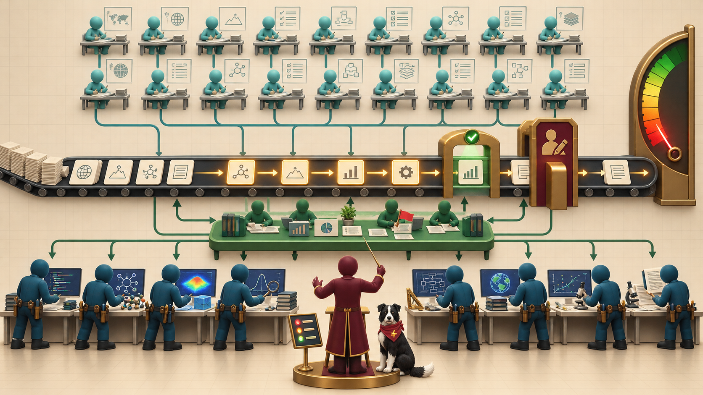
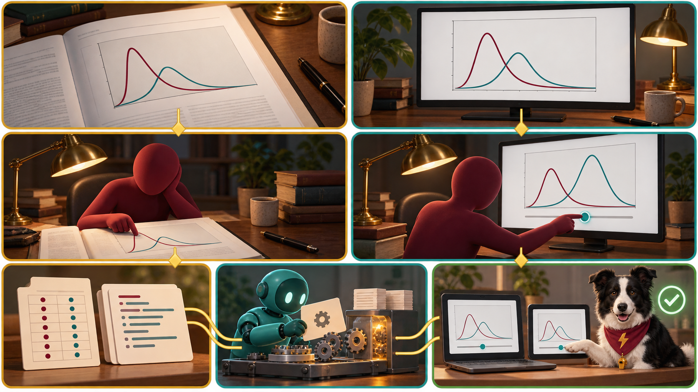
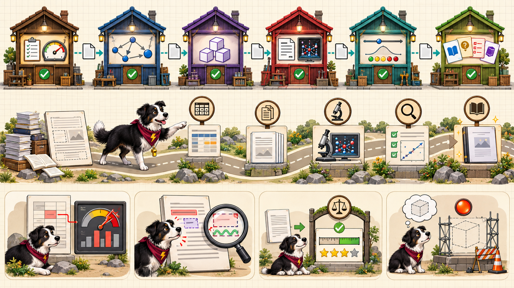

<!-- _class: lead -->
# AI for EE Research

## From Researcher to Orchestrator

A hands-on guide to using AI tools and agents for everyday research in electrical engineering and computer design

<!--
Welcome. This deck is a 20-slide tour of the whole book: the central idea,
how the 20 chapters are organized, and what a reader can do after finishing.
Each slide maps to one or two chapters. Speaker notes carry the detail.
-->

---

# The Problem: Research Is a Pipeline

- Literature search
- Data analysis
- Brainstorming and problem framing
- Scientific coding and simulation
- Manuscript preparation

**AI can now absorb a large share of each stage, but only for researchers who know how to direct it, check it, and own the result.**

<!--
Chapter 1. Graduate research in EE and computer design is a chain of repeatable
tasks with checkable outputs. The pipeline is only as trustworthy as its weakest
stage. AI absorbs much of the procedural layer; what it cannot supply is the
question, the domain judgment, and the accountability.
-->

---

# The Big Idea: Researcher as Orchestrator

- Stop doing every task personally
- Coordinate **~20 planning agents** and **~10 execution agents**
- You set direction, supply domain judgment, resolve conflicts, and decide what is true
- You stay accountable for the science

<!--
The 20:10 ratio reflects that plans are cheap to discard while executions are
expensive to check. The number of agents matters least; dependencies, review
cost, and handoff quality set what the team can deliver (Chapter 10).
-->

---

# Who It Is For

**Audience:** MS and PhD students, postdocs, and faculty in EE, computer engineering, and computer design

**Prerequisites**

- Graduate standing or equivalent research experience
- One programming language, preferably Python
- Command line, text editor, and Git basics
- No prior ML, prompt engineering, or agent experience

<!--
The course deliberately does not cover training LLMs, ML theory, AI chip design,
vendor EDA flows, or legal advice. It assumes students bring their own EE domain
knowledge and teaches how to direct AI at it.
-->

---

# How the Book Is Organized

| Part | Chapters | Theme |
|---|---|---|
| **1. Foundations** | 1–4 | Workflows, how LLMs work, prompts, context |
| **2. Memory and skills** | 5–7 | Markdown, Git, knowledge graphs, skills |
| **3. Agents and teams** | 8–10 | Tools, supervision, orchestration |
| **4. Research tasks** | 11–15 | Literature, data, code, ideas, manuscripts |
| **5. Communicate and trust** | 16–20 | MicroSims, verification, ethics, agents, capstone |

<!--
Every chapter ships with annotated references and a quiz. The book also has a
glossary of 379 terms, a learning graph with 379 concepts, 48 interactive
MicroSims, 20 infographic posters, and two appendices (Personal Agents and
Personal Knowledge Graphs).
-->

---

# Foundations: How Language Models Work

*Chapters 2–3*

- Text becomes **tokens**; the **context window** is a shared budget
- Models optimize **plausibility, not truth**, so fluent answers can be false
- Fabricated citations come from this, not from a bug
- Choose models by capability, cost, latency, privacy, and reproducibility
- A prompt is a **specification**: instructions, constraints, roles, examples

<!--
Chapter 2 explains tokens, context windows, training data, knowledge cutoffs,
and hallucination. Chapter 3 turns that into choices: API access (keys are
secrets), cost and rate limits, when a local open-weight model is the right
answer, and the first prompting techniques.
-->

---

# Context Engineering

*Chapter 4*

- Decide **everything** the model sees
- Task spec: goal, inputs, outputs, constraints, definition of done
- Ground answers in sources
- Chain prompts with checks between steps
- Defend against **prompt injection**

<!--
Reliability comes less from clever wording than from complete specification,
selected and grounded context, checks between steps, and tested, versioned
prompts. Defining domain vocabulary (resolution, gain, noise) prevents silent
misreadings.
-->

---

# Memory: Markdown, Git, and Knowledge Graphs

*Chapters 5–6*

- **Markdown** is readable by both humans and agents
- **AGENTS.md / CLAUDE.md** hold goals, conventions, constraints
- **Git** gives history and recovery
- A **personal knowledge graph** links notes, papers, experiments, and people as queryable entities

<!--
An agent is only as reliable as the project it works in. Plain text, a short
checkable instruction file, a predictable layout, and version history give
memory, boundaries, and recovery. A knowledge graph with typed links can be
queried to ground an agent's answers; Appendix B covers building one.
-->

---

# Agent Skills: Repeatable Tasks as Commands

*Chapters 6–7*

- Anatomy: name, description, instructions, supporting files
- One-sentence scope; **single-purpose** skills
- **Progressive disclosure** keeps context small
- Test that it fires, stays quiet, and gives known answers
- Version, share, and maintain

<!--
A skill is worth the effort when a task recurs and the result can be checked.
Chapter 7 covers trigger tests including near misses, behavior tests with known
answers, evaluation of pass rate across repeated runs, and a research skill
template.
-->

---

# Agents, Tools, and Subagents

*Chapter 8*

- Agent = **model + tools + loop**
- Decide, call a tool, observe, repeat
- File access, shell, code execution, MCP
- **Sandboxing** and permissions set the limits
- **Subagents** run in parallel with isolated context

<!--
An agent's power and its risk are the same quantity: what its tools can reach.
Early errors compound across loop iterations, so version control is the safety
net. Setting limits is what lets you use agents with confidence.
-->

---

# Supervising Agents and Assigning Roles

*Chapter 9*

- **Autonomy is a dial** set per task
- Set it by reversibility, reach, and verifiability
- Log everything; bound cost and runtime
- Know the failure modes: premature completion, scope drift, test weakening, runaway loops
- Roles: planner, executor, reviewer, researcher, coder, writer

<!--
Supervision is the design of where a human looks. Each failure mode has a
mechanical defense. Roles make a group of agents legible.
-->

---

# Orchestrating Agent Teams

*Chapter 10*

- Break work into tasks with owners, outputs, and checks
- **Dependencies** set the critical path, and parallelism cannot shorten it
- Handoffs through files and a shared workspace
- **Review checkpoints** and human approval gates
- Scaling stops paying off when **review cost** exceeds the work saved

<!--
Orchestration is the design of how work, checks, and decisions flow so that your
attention prevents the most damage. Span of control and review load limit the
useful team size; the MicroSims on critical path and review load let students
experiment with both.
-->

---

# Literature Search and Synthesis

*Chapter 11*

- Write a **repeatable search strategy**
- Favor **recall** when scoping, then triage for precision
- Chain citations forward and backward
- **Verify every citation** against the source
- Tie claims to locations in sources

<!--
AI changes the speed of every stage of the literature workflow and none of the
standards. A fluent fake citation looks identical to a real one, so verification
is a required step, not an optional one.
-->

---

# Data Analysis, Simulation, and Code

*Chapters 12–13*

- Record measurement settings; keep raw data **read-only**
- Cleaning is a **logged script**; outliers are information
- **Silent errors** run cleanly and return wrong numbers
- Test with **known answers**
- Apply numerical sanity checks and pin environments

<!--
Example from Chapter 13: a 10 versus 20 log10 mistake turned a 10-bit converter
into an 18-bit one. Code from an agent is a hypothesis about how to compute a
result; the chapter is how you test that hypothesis.
-->

---

# Brainstorming and Manuscripts

*Chapters 14–15*

- AI offers **volume and range**; its weakness is **agreement**
- Use a devil's advocate prompt and check analogies
- Move from hunch to **falsifiable hypothesis**
- Draft from evidenced claims; abstract last
- Protect **your voice** and **your numbers**

<!--
Chapter 14 separates divergent and convergent idea phases and ranks ideas in a
table with assumptions and failure conditions. Chapter 15 follows a paper from
outline through LaTeX, figures, references, venue rules, and arXiv submission.
Argument-bearing sections stay human-written.
-->

---

# MicroSims: Communicating by Interaction

*Chapter 16*

- Match the **medium** to the point
- A static figure shows a fact; an **interactive** shows a dependence
- A MicroSim is small, single-concept, embeddable
- Built with **p5.js** and built-in controls
- Specify precisely, then check what the agent builds

<!--
This book contains 48 MicroSims that students use to sort, predict, calculate,
and judge. Chapter 16 shows how to generate one from a precise specification,
and the same approach extends to intelligent textbooks and slide decks like
this one.
-->

---

# Verification and Reproducibility

*Chapter 17*

- **Verification:** done right? **Validation:** the right work?
- **Independent checks** with different failure causes
- Primary-source and cross-model checks
- Fix success criteria **before** seeing the result
- Audit trails and reproducibility packages

<!--
Agreement between models is weak evidence; disagreement is a flag. Verification
is not a final stage but a habit that runs through the whole workflow. AI raises
the volume of output and adds failure modes that sound plausible, so every check
matters more.
-->

---

# Responsible and Ethical Use

*Chapter 18*

- **Accountability** cannot be delegated; AI is not an author
- **Disclose** AI use per venue and institutional policy
- Protect **confidential** data, participant data, and unpublished results
- Respect licensing and intellectual property
- Check for bias; keep your own skills sharp

<!--
Unpublished results pasted into a hosted tool are disclosed to a third party.
Keep a log as you work so the disclosure statement is accurate. The chapter ends
with drafting a responsible-use policy for a research group.
-->

---

# Personal Agents and Case Studies

*Chapters 19–20*

- **Always-on agents** (Grok Bot, Dots, Muse, Claude Cowork, OpenClaw, Hermes Agent)
- Judge them by **criteria**, not brands: where they run, what they reach, cost, data
- Real cases, **including failures**: the MicroSims arXiv paper, this textbook's skill pipeline
- **Capstone:** an end-to-end task with an agent team, plus an adoption plan

<!--
Products change monthly, so Chapter 19 teaches durable criteria: blast radius,
usage metering, data exposure, vendor-claim verification, and overnight activity
audits. Chapter 20 applies the whole toolkit; each case records cause,
detection, control, and change for what failed.
-->

---

<!-- _class: lead -->
# Key Takeaways

- **Direct, check, and own** — the researcher stays accountable
- **Context and memory** make agents reliable: Markdown, Git, knowledge graphs, skills
- **Autonomy is a dial** set per task, bounded by logs and review
- **Verify independently**; disclose AI use
- Start small, then adopt in order

**Read the book:** dmccreary.github.io/ai-for-ee-research

<!--
Close by pointing to the quizzes, MicroSims, and posters for self-study, and to
the capstone chapter for an adoption plan. Invite questions.
-->
